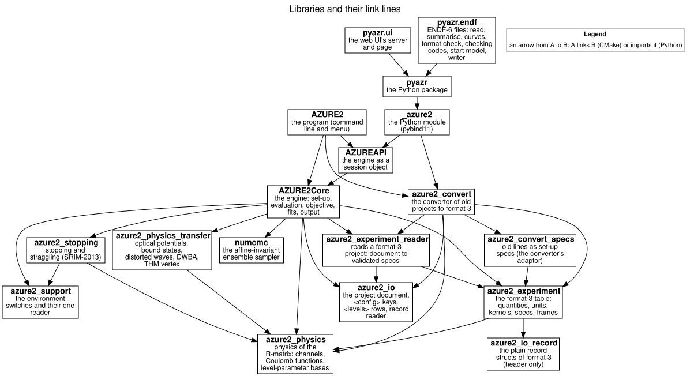

Code Architecture
=================

AZURE2 is one C++ calculation engine with two front ends: the program
``AZURE2`` (command line and menu) and the Python package ``pyazr``, with
the web UI built on ``pyazr``. Both read the same format-3 ``.azr`` project
through the same code and must give the same numbers. This page is the map:
the libraries and what each may depend on, then a run step by step.
:doc:`classes` draws the main types; :doc:`state_and_ownership` says who owns
what; :doc:`extending` lists the places a new feature touches.

The libraries
-------------

Each library is a CMake target; a library may use only the targets on its
link line, so a wrong dependency does not compile. The figure is drawn from
the link lines (``target_link_libraries`` in each ``CMakeLists.txt``).

   The libraries and their link lines. An arrow goes from a library to one it
   links (for ``pyazr``: imports). Source: ``figures/classes.tsv`` and
   ``figures/arrows.tsv`` (:doc:`classes`).

``support/`` (target ``azure2_support``)
   Plumbing every library may use, and which uses nothing: the table of
   environment switches and the one reader of the process's environment
   (``azure2::support::ProcessEnvironment``, ``Switch``,
   ``support/include/azure2/support/Environment.h``). It must not know any
   physics.

``physics/`` (``azure2_physics``, ``azure2_physics_transfer``)
   The physics of the R-matrix as functions of values: angular coupling,
   channel functions (penetrability, shift, Coulomb phases), the Coulomb
   functions (``physics/coulomb/``), level-parameter bases
   (``LevelParameters.h``), the reaction system (``azure2::physics::System``,
   ``JpiBlock``), external capture, widths, constants. The target
   ``azure2_physics_transfer`` (``physics/src/transfer``) adds optical
   potentials, bound states, distorted waves, the DWBA amplitude and the THM
   vertex, and links ``physics/`` only. ``physics/`` links nothing: no engine
   header, no GSL, no OpenMP; it also builds as a project of its own.
   :doc:`physics_core` lists it.

``io/`` (``azure2_io``, ``azure2_io_record``)
   The project file as a lossless document (``azure2::io::Document``), the
   ``<config>`` keys (``io::ConfigKeys``, ``io/src/ConfigSection.cpp``), the
   ``<levels>`` rows (``LevelRow``, ``LevelSection``) and the record reader.
   ``azure2_io_record`` is the header ``Record.h`` alone, the plain record
   structs, so that ``experiment/`` can validate records without the reader.
   ``io/`` uses nothing else of AZURE2.

``stopping/`` (``azure2_stopping``)
   Stopping and straggling: materials, SRIM-2013's electronic and nuclear
   stopping (data files in ``stopping/data/srim/``), energy loss, range and
   straggling, with uncertainty and provenance. Links ``physics/`` and
   ``support/``. The engine reaches it through ``TargetStopping``
   (``src/TargetStopping.cpp``), ``pyazr`` through ``pyazr.stopping``.

``experiment/`` (``azure2_experiment``, ``azure2_experiment_reader``)
   The table of project format 3: record kinds and fields
   (``experiment/src/Schema.cpp``), quantities (``Quantities.cpp``), units
   (``Units.cpp``), apparatus kernels (``Kernels.cpp``), lab to c.m. frames
   (``Frames.h``), the expression trees of a data set's prediction
   (``Prediction.h``), and the build of the set-up specs (``Build.cpp``,
   ``SetupSpecs.h``). ``azure2_experiment`` links ``physics/`` and
   ``Record.h`` only; ``azure2_experiment_reader`` adds ``io/`` and reads a
   whole project (``ReadFormat3Project``, ``ProjectReader.h``). It must not
   know the engine.

``convert/`` (``azure2_convert``, ``azure2_convert_specs``, ``azure2_convert_lines``)
   Everything that knows the old project formats: their line parsers
   (header-only ``azure2_convert_lines``), the converter to format 3
   (``Convert.h``), and the old lines as set-up specs
   (``SpecsFromOldLines.h``). The engine library does not link it; the
   program (``AZURE2 --convert``) and the Python module do.

``src/``, ``include/`` (``AZURE2Core``, the program ``AZURE2``)
   The engine: the compound nucleus (``CNuc``), the data set and its working
   copies (``DataSet``, ``WorkingCopy``), the set-up of meshes and target
   effects, the point pass and the level-matrix routes, the model pass, the
   objective (``src/Objective.cpp``), the gradients, the fitters' adapters,
   the output files. It links every library above, Minuit2, GSL and BLAS.
   ``src/AZURE2.cpp`` (``main``) and ``src/ProjectCommands.cpp`` (the project
   commands ``--convert``, ``--validate``, ``--describe``, ``--schema``) make
   the program.

``api/`` (``AZUREAPI``, the module ``_azure2``)
   ``AZUREAPI`` (``api/include/AZUREAPI.h``) holds a set-up engine as a
   session; the pybind11 module ``_azure2`` (``api/src/pybind_*.cpp``) binds
   it as ``_azure2.Session`` and binds the document, the record grammars, the
   schema, the physics functions and the stopping. Python hands over names and
   numbers; every grammar and formula stays in C++. :doc:`api` describes it.

``numcmc/`` (``numcmc``)
   The affine-invariant ensemble sampler (``nu::Mcmc``, ``nu::Ensemble``,
   ``nu::Walker``), linked into the engine when ``USE_MCMC`` is on.

``pyazr/``, ``pyazr/ui/``
   The Python package: ``Project`` (``project.py``, ``nuclear_part.py``) edits
   the engine's document; ``Session`` (``session.py``) is a session; bands,
   transformations, library readers and the command line ``python -m pyazr``
   (``cli.py``). ``pyazr/ui`` is the web UI: a server (``server.py``, the
   route table ``routes.py``), session workers (``workers.py``, ``engine.py``),
   jobs (``jobs.py``) and a page of plain JavaScript (``pyazr/ui/static``).

``external/``
   Vendored upstream code, built in-tree and never edited: Minuit2
   (``external/minuit2``).

The tools ``azure2-coulomb-table`` (``src/coulomb_table_main.cpp``) and
``azure2-stopping`` (``stopping/tools/azure2_stopping.cpp``) are small
programs on the same libraries.

How the package is built. A developer's build is the CMake build of the
repository: it writes ``_azure2`` into ``pyazr/`` (or ``PYAZR_OUTPUT_DIR``)
and every test imports pyazr from the checkout. A user's ``pip install .`` (or
``pip wheel .``) goes through ``pyproject.toml``: scikit-build-core runs the
same CMake files with the option set of a wheel (``BUILD_TESTING`` and
``USE_READLINE`` off, the vendored sampler on; targets ``_azure2`` and ``AZURE2``),
installs the module into the package and the program into the wheel's scripts
(the install rules of component ``python``, keyed on ``SKBUILD``), and copies
the package directory as it is, less ``wheel.exclude``. The package finds its
data files next to its own modules; ``pyazr/datafiles.py`` lists them. The
workflow ``.github/workflows/wheels.yml`` builds and tests wheels for Linux
and macOS with cibuildwheel and publishes nothing.

A run, step by step
-------------------

The same chain for the program and for a ``pyazr`` session; where they differ
is said at each step. The objects named are drawn in :doc:`classes`.

1. **Project file to document.** ``Config::ReadConfigFile``
   (``src/Config.cpp``) reads the file once: ``io::Document::Parse`` keeps it
   as lossless lines; a file that is not format 3 is refused with the
   conversion command (``io::NotFormat3Message``). Then
   ``Config::ReadFormat3Project`` calls
   ``azure2::experiment::ReadFormat3Project``
   (``experiment/src/ProjectReader.cpp``): the records are read, validated
   against the table (``Schema``), the ``<levels>`` rows are read
   (``LevelSection``, ``LevelTablesOfRows``) and ``Schema::Build``
   (``experiment/src/Build.cpp``) turns the records into specs
   (``BuiltProject``: ``DatasetSpec``, ``ExtrapolationSpec``,
   ``TargetEffectSpec``, abundances, model data). The result is held as
   ``Config::project``, a ``shared_ptr<const Format3Project>``. The
   ``<config>`` keys are applied by ``ApplyProjectOptions``
   (``src/ProjectOptions.cpp``) from the rows of ``io::ConfigKeys``.

   *Program*: ``main`` (``src/AZURE2.cpp``) first runs the project commands
   (``RunProjectCommand``), parses the flags into ``Config``
   (``parseOptions``), calls ``Config::ReadConfigFile`` and
   ``Config::ResolveMatrixRoute``, and shows the menu. *pyazr*:
   ``pyazr.Session(...)`` builds ``_azure2.Session``
   (``api/src/pybind_api.cpp``), which makes a ``Config``, applies the
   keywords of the call (``RuntimeOptions``, ``apply_options``) and calls the
   same two functions. ``pyazr.Project`` reads the file with the same
   ``_azure2.Document`` and edits it with the engine's grammars; it does not
   evaluate anything.

2. **Set-up.** ``SetUpRun`` and ``SetUpObjective`` (``src/RunSetUp.cpp``,
   the first stages ``AZUREMain::operator()`` calls; ``include/ProgramRun.h``)
   for the program, ``AZUREAPI::Initialize`` (``api/src/AZUREAPI.cpp``) for a
   session, make the same calls in the same order:

   * ``CNuc::Fill`` (``src/CNuc.cpp``): the pairs (``PPair``) and the
     :math:`J^\pi` groups (``JGroup``) with their channels (``AChannel``) and
     levels (``ALevel``), from the ``<levels>`` rows
     (``ProjectLevelSection``, ``src/ProjectSetup.cpp``).
   * ``WorkingCopy::Fill`` (data sets) or ``WorkingCopy::MakePoints``
     (extrapolations), ``src/WorkingCopy.cpp``: first the samples of the
     ``<abundances>`` block (``AbundanceSamples``, held by the ``DataSet``;
     ``WorkingCopy::SetAbundanceSamples``, ``src/ProjectSetup.cpp``), then the
     segments and their points from the specs, the target effects
     (``WorkingCopy::SetUpTargetEffects``, ``src/TargetSetup.cpp``: the
     kernels, the shared energy mesh of each compound nucleus by
     ``PlanMesh``, ``include/MeshPlanner.h``, and the slots of the folded
     points), then the calculation plan (``WorkingCopy::BuildPlan``). The
     data set is written through ``WorkingCopy::Draft`` while it is set up.
   * The entrance pairs of the run, from the specs of its active data sets or
     extrapolations (``RequestDataEntrances``,
     ``RequestExtrapolationEntrances``, ``src/ProjectSetup.cpp``) or the
     rate's entrance pair, requested with ``CNuc::RequestEntrance``, and the
     capture analyzing-power terms (``RequestCaptureAyTerms``).
   * ``CNuc::Initialize``: channels, boundary conditions, the
     transformation of the input parameters to the engine's basis
     (``CNuc::TransformIn``) and the pathway table (``CNuc::BuildPathways``,
     for the requested entrance pairs).
   * ``CNuc::FillMnParams`` and ``WorkingCopy::FillMnParams`` lay the fit
     parameters out in ``AZUREParams``, each with its ``ParameterRecord``: the
     level block, then the abundance block (``AbundanceSamples::AddParameters``,
     the one place that writes the abundances into a parameter vector and
     reads them back), then the data's parameters.
   * ``WorkingCopy::Initialize``: the energy-dependent values of every
     point and slot (``CalcEDependentValues``: channel functions through the
     stage's ``ChannelTable``, Legendre rows, Coulomb amplitudes), the
     external-capture amplitudes (``CalculateECAmplitudes``), the leaves of
     sums and ratios (``InitializeLeaves``), the shared angular rows
     (``BuildRowSets``), the layout of the result records
     (``LayoutResults``) and the node table (``BuildNodeTable``,
     ``src/NodeTable.cpp``). At its end the ``DataSet`` is frozen
     (``WorkingCopy::Freeze``): from then on it is only read.

3. **Hand-over of a parameter vector.** ``CNuc::FillCompoundFromParams``
   puts the vector's level parameters into the levels;
   ``WorkingCopy::FillNormsFromParams`` and
   ``WorkingCopy::FillEnergyShiftsFromParams`` set norms, energy shifts,
   the isotopic abundances, the THM coherent backgrounds and the
   apparatus parameters, re-place the slots of shifted folds where the shift
   leaves their reach (``WorkingCopy::ReplaceSubPointGrids``) and end with
   ``WorkingCopy::BeginEvaluation``, which sizes the caller's ``Results``.
   With the Brune basis, ``CNuc::CalcShiftFunctions`` follows.

4. **Point pass.** ``WorkingCopy::CalculatePointsInParallel``
   (``src/EnergyPass.cpp``): ``CalculationPlan::EnergyTasks`` groups every
   unit (a point, or a slot of a folded point) by compound nucleus, route and
   energy; each energy task runs ``SolveAtOneEnergy``: the level matrix is
   filled and factored once (``AMatrixFunc``, ``LevelMatrixSolver``; the
   channel-matrix route ``RMatrixFunc`` when the A-matrix is off), a T-matrix
   is built once per (entrance, exit) group and every unit's observable is
   written into its record of ``Results``. Then each folded point is folded
   over its slots (``Unit::FoldSubPoints``, ``src/PointPass.cpp``;
   ``FoldPoint``, ``src/PointFold.cpp``). :doc:`level_matrix` and
   :doc:`data_model` describe both halves.

5. **Model pass.** ``azure2::EvaluateModel`` (``src/ModelPass.cpp``): the
   value each data or test point predicts, from its leaves by the segment's
   expression tree (sums, ratios, S factors, samples, yields), into
   ``Results::model``.

6. **Objective.** ``Objective::Engine().Chi2`` (``src/Objective.cpp``) sums
   the ordered list of terms over an ``ObjectiveContext``: the data
   :math:`\chi^2` with each segment's priors, the data covariance, the
   nuisance priors, Park's :math:`J > 0` wall, the apparatus and abundance
   priors, the model data, the prior covariance.

   *Program*: steps 3 to 6 are ``AZURECalc::operator()``
   (``src/AZURECalc.cpp``), Minuit2's function; during a fit each evaluation
   takes a pooled copy of ``CNuc`` and of the working copy with its own
   ``Results`` (``AZURECalc::GetPooledCNuc``, ``GetPooledData``). *pyazr*:
   ``Session.objective()`` is ``AZUREAPI::CalculateObjectiveRWA`` as an object for a fitter or sampler
   (``pyazr.Objective``), which runs the same hand-over, point pass, model pass and ``Objective::Engine()`` on
   the session's own objects, and
   ``Session.evaluate(x)`` one evaluation with its terms and every data set's
   arrays (``pyazr.Evaluation``, ``AZUREAPI::EvaluateObjectiveRWA``).

7. **Fit or sampler.** The fitters are one table, ``Fitters()``
   (``src/Fitters.cpp``, ``include/Fitters.h``): a row per fitter with its
   name, the program's switch, what it needs (gradient, residual rows,
   bounds), whether it yields a covariance or allows MINOS, and its
   function, ``FitResult run(AZURECalc &, AZUREParams &, const FitControl &)``:
   ``FitMigrad`` and ``FitMigradGradient`` (``src/FitMigrad.cpp``: Minuit2's
   ``MnMigrad``, the second with the analytic gradient
   ``AZURECalc::Gradient``, the reverse-mode adjoint of ``src/AZUREGrad.cpp``
   and ``src/GradEnergyTasks.cpp``, and the rerun with a re-frozen relvector
   data covariance), ``FitLevenbergMarquardt`` (``src/FitLeastSquares.cpp``)
   and ``FitGslTrustRegion`` (``src/FitGslTrustRegion.cpp``) on the residual
   rows, ``FitNLopt`` (``src/FitNLopt.cpp``). ``FitControl``
   (``include/FitControl.h``) carries the call limit, the progress sink, the
   checkpoint, the caller's stop request and the log stream; ``FitResult`` the
   end point, the objective, the status, EDM, calls, the covariance and the
   MINOS intervals. While a fitter runs, ``FitEvaluations``
   (``src/FitEvaluations.cpp``) is the objective's ``EvaluationObserver``:
   it counts the evaluations, keeps the best point and hands each as a
   ``FitProgress`` record to the sink; the stop request makes every later
   evaluation return 0 at once. HESSE and MINOS are ``RunHesse`` and
   ``RunMinos`` on a ``FitResult`` (``src/FitErrors.cpp``). *Program*:
   ``RunFitStage`` (``src/ProgramFit.cpp``) takes the row of the switches
   (``FitterOfConfig``), prints the progress lines and writes the
   intermediate files through ``ProgramProgress``, then HESSE for the band,
   MINOS, ``fitStatus.out``, ``covariance_matrix.out`` and ``param.sav``.
   The sampler is ``runMCMC`` (``src/AZURE2.cpp``), which sets up its own
   ``CNuc`` and ``WorkingCopy`` and runs ``AZURECalcMCMC::RunMCMCSampling`` on
   ``nu::Mcmc``. *pyazr*: ``Session.fit_with_engine`` runs a row on the
   session (``AZUREAPI::FitWithEngine``, ``api/src/AZUREAPIFit.cpp``; the
   binding releases the GIL), or the fit is Python's (SciPy or iminuit on
   ``Session.objective().value_and_grad``; the web UI runs them as jobs,
   ``pyazr/ui/jobs.py``), with the same gradient through ``AZUREAPI``.

8. **Output.** *Program*: ``FinalEvaluation`` and ``WriteRunOutputs``
   (``src/RunOutputs.cpp``: the band, then the files below), the reaction rate
   and the transformation out (``src/AZUREMain.cpp``).
   ``WorkingCopy::WriteOutputFiles``
   (``src/DataOutputFiles.cpp``: ``AZUREOut_*``, ``chiSquared.out``,
   normalizations, shifts), ``WriteParametersOut``
   (``src/CNucReport.cpp``), ``CNuc::TransformOut`` (the observed and Brune
   parameters) and ``ReactionRate``. A session writes the same files on
   request (``Session.write_output_files``).

.. note:: **Planned.**
   ``CNuc`` will be split into an immutable ``CompoundSystem`` built once at
   set-up and shared by every evaluation, the levels' input values
   (``LevelInputs``) and a per-evaluation ``LevelState``; an evaluation then
   reads ``(const CompoundSystem &, const LevelState &)`` where it reads
   ``CNuc *`` today. In ``pyazr`` the ``Objective`` and ``Evaluation``
   objects take the place of the session's ``calculate_*`` methods.

Caches and their signatures
---------------------------

Expensive intermediate results are written next to the project and reused:
external-capture integrals (``output/intEC.dat``, ``intEC.extrap``), their
energy tables (:doc:`ec_table`), and the Coulomb-function table
(:doc:`coulomb_table`). Each file carries a signature of everything that
determines its contents (for example ``WorkingCopy::ECSignature``) and is
recomputed when the signature does not match. A change that alters what a
cache would contain must change its signature, or old files are reused with
the old physics.
