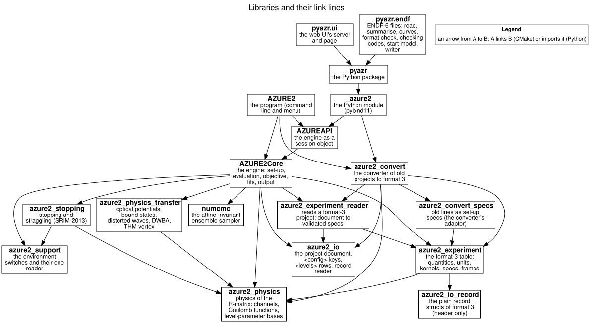
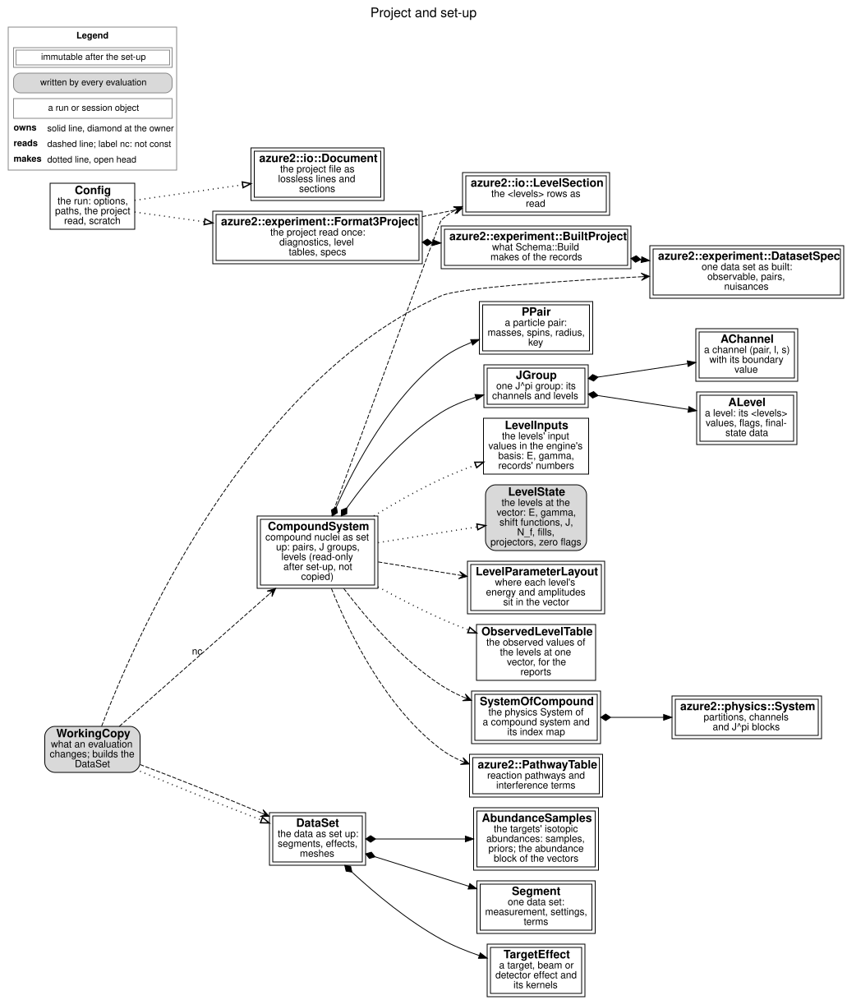
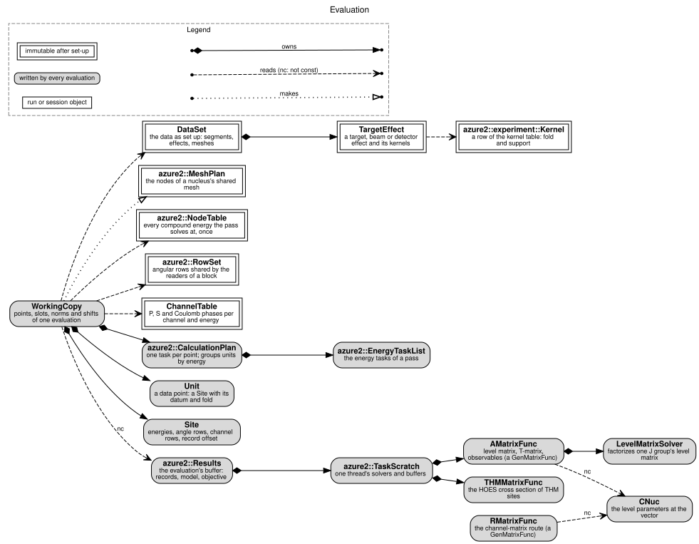
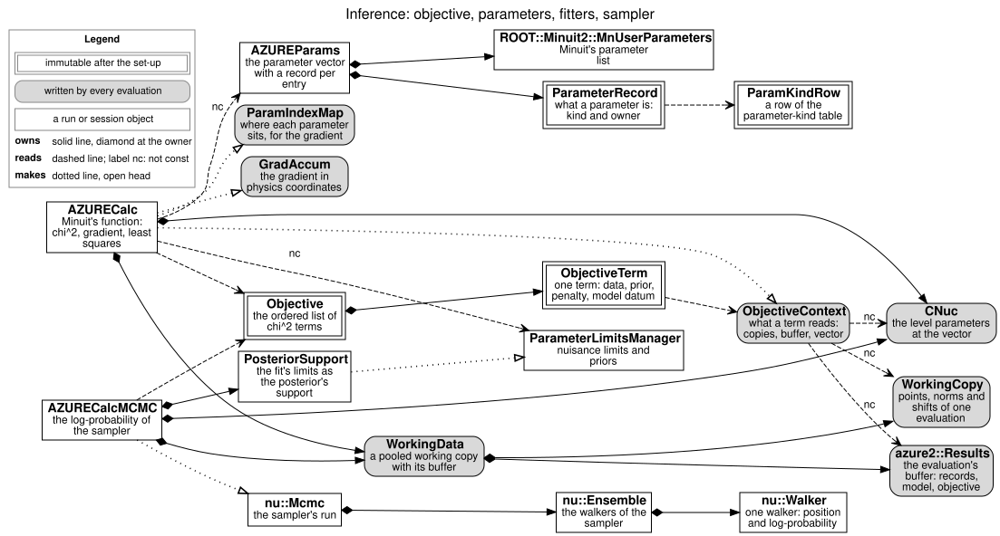
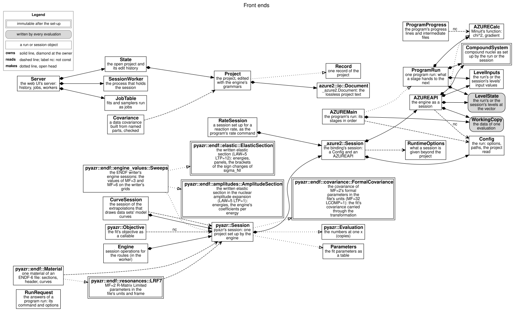

The Scheme of the Classes
=========================

Five figures: the libraries, then one per layer of the engine with the types
a reader needs to follow a run (:doc:`architecture`). They are not every
class: helpers, the THM types and the output writers are left out.

How to read them
----------------

Each box is a type of the code with its job in a few words; a name with a
namespace (``azure2::``, ``azure2::experiment::``, ``nu::``) is written with
it. The box tells what state the object is in during a fit:

- **double border**: immutable after the set-up -- built once, then only read,
  and shared by every evaluation and thread (:doc:`state_and_ownership`);
- **rounded, grey**: written by every evaluation -- the parameter vector's
  values, the points' energies after a shift, the results; each evaluation
  that runs at the same time has its own;
- **plain**: an object of the run or of the session (the options, the fitter,
  the front end), neither of the two.

The arrows are of three kinds:

- **owns** (solid, diamond at the owner): holds it by value, in a container or
  through ``std::unique_ptr`` or ``new``; it lives and dies with the owner;
- **reads** (dashed): holds it or takes it as an argument without owning it;
  through ``const`` (a ``const`` reference or pointer, a
  ``std::shared_ptr<const T>``) unless the arrow is labelled *nc*, where the
  code passes a non-``const`` pointer or reference;
- **makes** (dotted, open head): constructs it or returns it.

Inheritance is not drawn; a box says it in words (``AMatrixFunc``, "a
``GenMatrixFunc``"; ``Unit`` is a ``Site``). Every arrow is backed by a
member, an argument or a call, named in the column ``where`` of the table
``figures/arrows.tsv``.

Libraries
---------

   The libraries; an arrow goes from a target to a target on its link line.

``physics/``, ``support/`` and ``io/`` use nothing of AZURE2;
``experiment/`` uses ``physics/`` and the record header of ``io/``; the engine
``AZURE2Core`` uses all of them; the converter is linked by the program and
the Python module, not by the engine. :doc:`architecture` gives one
paragraph per library.

Project and set-up
------------------

   From the project file to the set-up objects.

``Config::ReadConfigFile`` parses the file into an ``azure2::io::Document``
and makes the ``Format3Project`` (validated records, the ``<levels>`` rows,
the specs of ``BuiltProject``), which ``Config`` keeps as
``std::shared_ptr<const Format3Project>``. ``CompoundSystem`` is filled from the
``<levels>`` rows: pairs (``PPair``) and :math:`J^\pi` groups (``JGroup``),
each with its channels (``AChannel``) and levels (``ALevel``: the values of
the ``<levels>`` rows, the fix flags, the external-capture final-state data;
nothing of a level is written after the set-up). The levels' input values in
the engine's basis (energies, widths or amplitudes, the ``gamma_decay``
records' numbers, whether the transformation ran) are a ``LevelInputs``.
The values at the parameter vector (fit energies and amplitudes, shift
functions and their derivatives, Park's :math:`J`, the external-capture
amplitudes and :math:`N_f^{1/2}`, the ``gamma_decay`` records' fills, the
formal-basis capture-mask projectors, and what an evaluation reads of the
input: the zero-width flags) are a ``LevelState``.
``CompoundSystem``'s fills and transformations are ``const`` and write the state and
inputs they are given (``FillCompoundFromParams`` with
``GammaDecaySet::ToEngine``, ``CalcShiftFunctions``, ``TransformIn``,
``FillCompoundFromParamsPhysical``, ``SetFitLevelParameter``,
``TransformOut``); every reader of an evaluation's values takes the
``LevelState`` it reads as an argument (the matrix functions hold the one
they are solved at), and every reader of the input values the
``LevelInputs``. ``CompoundSystem`` holds neither: each owner holds its own and hands it
to the readers -- the program's run and the session (made by ``SetUpCompoundSystem`` with the compound), a fit's
evaluations (copies of the caller's state in ``FitterStates``, their pool a
``StatePool`` owned by the caller), the sampler (``WalkerLevels``, its own
and a copy per walker, the idle ones in the caller's ``SamplerStates``), the reaction rate, a limit's conversion and the
sub-point grids. Where each level's energy and amplitudes sit in the
parameter vector is the ``LevelParameterLayout`` (``CompoundSystem::ParameterLayout()``,
built by ``Fill``): every walk of the level block reads it. ``CompoundSystem`` is not
copied (its copy constructor is deleted): one object, made by ``SetUpCompoundSystem``
(``include/CompoundSystemSetUp.h``) and owned by the run or the session as
``std::unique_ptr<const CompoundSystem>``, is shared constant by every owner, thread and walker; its
pairs, groups and channels do not change after the set-up, and the compiler
holds to it: its set-up calls are private to ``SetUpCompoundSystem``, and outside them it is reached through
``const`` pointers only (``GetPair``, ``GetJGroup``), levels included. Its files: the one set-up in
``src/CompoundSystemSetUp.cpp``, the set-up calls in
``src/CompoundSystemBuild.cpp`` and ``src/ExternalCaptureFinalStates.cpp``, the queries in
``src/CompoundSystem.cpp``, the transformations in ``src/LevelTransforms.cpp``, the fills of a state in
``src/LevelStateFill.cpp``, the parameter vector in ``src/LevelParameterVector.cpp``, its ``System`` in
``src/SystemOfCompound.cpp``, the channel functions it hands to ``physics/`` in
``src/EngineChannelFunctions.cpp``, its checks and reports in ``src/CompoundSystemChecks.cpp``,
``src/LevelReport.cpp`` and ``src/LevelInputMessages.cpp``. The observed values of the levels at a vector (Brune
energies and amplitudes, observed widths, ANCs and moments, the external parts)
are not stored on the levels: ``CompoundSystem::TransformOut`` returns them as an
``ObservedLevelTable``, which the reports (``WriteParametersOut``), the model
data and the observed parameter vector (``CompoundSystem::GetTransformParams``) read. The
entrance pairs are an input of the set-up's last part
(``CompoundSetUpRequests``, collected by the data's set-up with
``RequestDataEntrances`` or ``RequestExtrapolationEntrances``,
``src/ProjectSetup.cpp``). ``SystemOfCompound`` is the ``azure2::physics::System``
of a ``CompoundSystem``, built once by ``CompoundSystem::Fill``, and the
``PathwayTable`` is built from it once. ``WorkingCopy`` builds the
``DataSet`` (segments, target effects) from the ``DatasetSpec`` rows while it
is set up and then holds it as ``std::shared_ptr<const DataSet>``. The
targets' isotopic abundances are the data's too: the samples of the
``<abundances>`` block are an ``AbundanceSamples`` of the ``DataSet``, their
present values a vector of the working copy, and ``AbundanceSamples`` is the
one place that writes the abundance block into a parameter vector and reads it
back (fit's and observed vector alike).

Evaluation
----------

   What one evaluation reads and writes.

The working copy owns its points (``Unit``) and the slots of the folded
points (``Site``), the ``CalculationPlan`` and the energy tasks of the last
pass (``EnergyTaskList``); it reads the immutable tables built at set-up: the
``DataSet`` with its target effects and their kernels
(``azure2::experiment::Kernel``), the ``NodeTable``, the shared angular rows
(``RowSet``) and the ``ChannelTable``. The mesh of a compound nucleus
(``MeshPlan``) is made at set-up and again when an energy shift moves the
points beyond their planned nodes. Everything an evaluation computes goes into
the caller's ``Results``, whose ``TaskScratch`` (one per thread) holds the
solvers: ``AMatrixFunc`` with one ``LevelMatrixSolver`` per group, and
``THMMatrixFunc``. :doc:`level_matrix` and :doc:`data_model` describe them.

Inference
---------

   The objective, the parameters, the fitters and the sampler.

``AZURECalc`` is Minuit2's function. During a fit it takes, for every
evaluation, a ``LevelState`` and a ``WorkingData`` (a working copy with its own
``Results``) from its pools, reads the one ``CompoundSystem`` of its caller, makes an ``ObjectiveContext`` and asks
the one
``Objective`` (``Objective::Engine()``), whose ``ObjectiveTerm`` list is fixed.
``AZUREParams`` holds Minuit's parameter list with one ``ParameterRecord``
per parameter, whose kind is a row of ``ParamKindTable()``; the gradient makes
a ``ParamIndexMap`` and accumulates into a ``GradAccum``. ``AZURECalcMCMC``
is the sampler's log-probability on pools of its own; it drives ``nu::Mcmc``,
whose ``nu::Ensemble`` owns the walkers.

A fitter is a ``FitterRow`` of ``Fitters()``: its function takes the
objective, the ``AZUREParams`` (start in, end point out) and a ``FitControl``
(call limit, progress sink, checkpoint, stop request, log) and makes a
``FitResult``. While it runs, ``FitEvaluations`` is the objective's
``EvaluationObserver``: it owns the observer, counts the evaluations, keeps the
best point and hands a ``FitProgress`` per evaluation to the sink.

Front ends
----------

   The program, the session of the binding, pyazr and the web UI.

The program's ``AZUREMain`` and the binding's ``AZUREAPI`` own the same pair of
engine objects, ``CompoundSystem`` and ``WorkingCopy``, and set them up with the same
calls. The program's run is a ``ProgramRun`` handed from stage to stage; it
owns the objective (``AZURECalc``), whose progress lines and intermediate
files ``ProgramProgress`` writes; ``AZUREAPI::FitWithEngine`` makes an
``AZURECalc`` of its own for a session's fit. ``_azure2.Session``
(``api/src/pybind_api.cpp``) owns a ``Config`` and
an ``AZUREAPI``; ``pyazr.Session`` owns one of them and makes the
``pyazr.Objective`` (which keeps the session) and the ``pyazr.Evaluation``
(copies, no session). ``pyazr.Project`` owns
the project's ``Document`` and hands out ``Record`` objects; it does not
evaluate. In the web UI the ``Server`` owns the edit history (``State``, which
owns the ``Project``), the session worker and the job table; the session
itself lives in the worker process, where ``Engine`` owns a ``pyazr.Session``.

.. note:: **Planned.**
   ``CompoundSystem`` is made by four set-up calls with the data's set-up between the first and the last;
   one build that returns the finished object, held as ``std::shared_ptr<const CompoundSystem>``, is the next
   step. The tables below then change by those rows.

Changing the scheme
-------------------

The figures are drawn from two tables beside them:
``docs/source/developer/figures/classes.tsv`` (one row per box: type, file,
job, figure, kind, state) and ``docs/source/developer/figures/arrows.tsv``
(one row per arrow: from, to, kind, figure, access, where). A class that is
added, renamed, moved or deleted, or an ownership that changes, is an edit of
those rows; then

.. code-block:: bash

   python3 docs/source/developer/figures/make_figures.py

writes the ``.dot`` and ``.svg`` files (with Graphviz's ``dot``; the site's
build uses the committed SVGs and needs no Graphviz). Look at the figures
afterwards. Check 44 of ``tests/consistency/repo_consistency_test.py`` fails
while a row names a type that its file does not declare, or an arrow names a
box its figure does not have.
