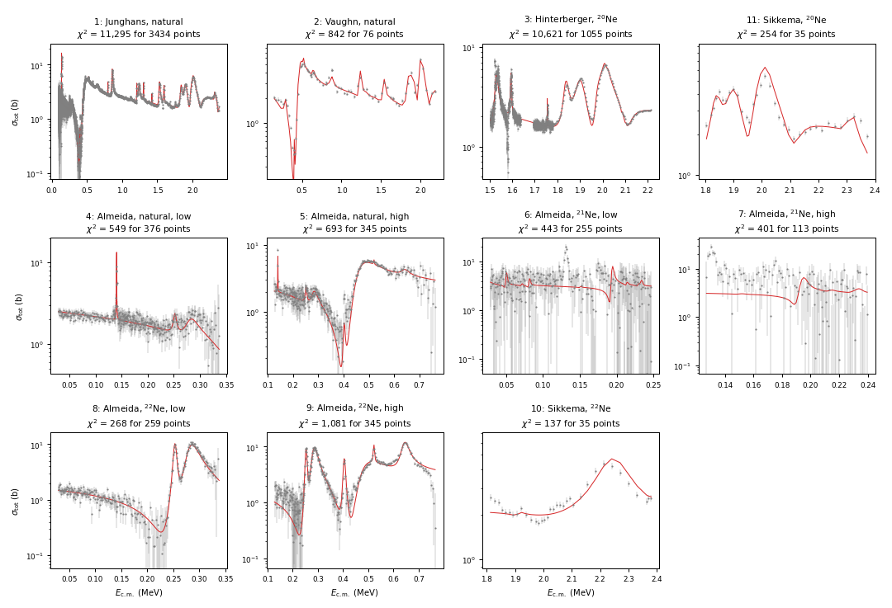
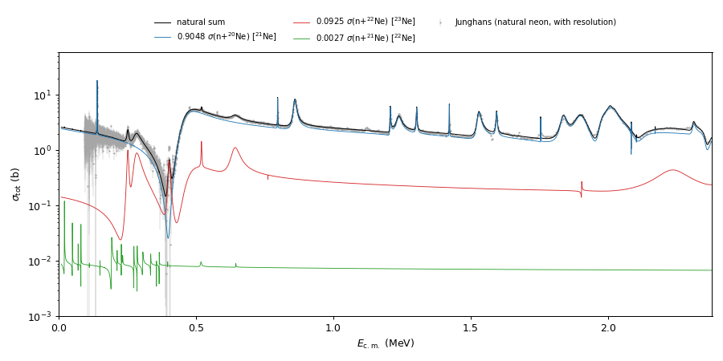

.. _example-natural-neon:

Worked Example: Neutrons on Natural Neon
========================================

This example fits every measured neutron total cross section of neon below
2.5 MeV with one AZURE2 project that holds three compound nuclei. Natural
neon is 90.48 % :sup:`20`\ Ne, 9.25 % :sup:`22`\ Ne and 0.27 %
:sup:`21`\ Ne, so a neutron total measured on a natural sample is

.. math::

   \sigma_{\mathrm{nat}}(E) = 0.9048\,\sigma(\mathrm{n}+{}^{20}\mathrm{Ne})
   + 0.0925\,\sigma(\mathrm{n}+{}^{22}\mathrm{Ne})
   + 0.0027\,\sigma(\mathrm{n}+{}^{21}\mathrm{Ne}),

a sum over the compound nuclei :sup:`21`\ Ne, :sup:`23`\ Ne and
:sup:`22`\ Ne. Measurements on enriched :sup:`20`\ Ne, :sup:`21`\ Ne and
:sup:`22`\ Ne samples see one term each. Together they separate the three
nuclei: the enriched data pin the minor isotopes, and the natural data,
which dominate in number and precision, constrain :sup:`21`\ Ne.

The :sup:`21`\ Ne levels above the neutron threshold are also the
resonances of :sup:`17`\ O(α,n)\ :sup:`20`\ Ne and
:sup:`17`\ O(α,γ)\ :sup:`21`\ Ne, which decide whether :sup:`16`\ O is a
neutron poison in the weak s process. The pair α+\ :sup:`17`\ O is
therefore part of the model, although no α data are fitted here.

The example uses:

- particle pairs that form several compound nuclei, and the inferred
  **Compound Nucleus** of each pair (:doc:`../user_guide/particle_pairs`);
- levels of three nuclei in one ``<levels>`` block
  (:doc:`../user_guide/levels_channels`);
- the ``<abundances>`` block;
- *sample* segments: natural-target sums, next to plain segments for the
  enriched samples (:doc:`../user_guide/segments`);
- an energy-dependent time-of-flight resolution and constant Gaussian
  resolutions (:doc:`../user_guide/experimental_effects`);
- normalization priors (:doc:`../user_guide/chi_squared`);
- the per-nucleus decomposition file ``AZUREOut_sample_seg=<key>``
  (:doc:`../reference/output_files`).

The files
---------

Everything is in ``examples/natural_neon/`` of the AZURE2 repository:

.. list-table::
   :header-rows: 1
   :widths: 30 70

   * - File
     - Contents
   * - ``natural_neon.azr``
     - The project: 7 pairs, 88 levels in three nuclei, the natural
       abundances, 11 data segments, 1 test segment, 4 resolution lines.
       The levels are at their fitted values; the normalizations are at
       their nominal value 1.
   * - ``natural_neon_fit.sav``
     - The full fitted parameter set, including the fitted normalizations.
   * - ``data/*.dat``
     - The 11 data sets (laboratory energy in MeV, total cross section in b,
       uncertainty in b).
   * - ``plot_natural_neon.py``
     - Draws the two figures of this page from ``output/``.

The data
--------

.. list-table::
   :header-rows: 1
   :widths: 5 33 15 14 8 11 14

   * - Key
     - Data set
     - Sample
     - :math:`E_{\mathrm{lab}}` (MeV)
     - Points
     - Norm. prior
     - Resolution
   * - 1
     - Junghans *et al.*, EPJ Web Conf. **239**, 01006 (2020), nELBE
       (EXFOR 23755005)
     - natural
     - 0 -- 2.5
     - 3,434
     - fixed at 1
     - nELBE time of flight
   * - 2
     - Vaughn *et al.*, Phys. Rev. **118**, 683 (1960) (EXFOR 11106003)
     - natural
     - 0 -- 2.33
     - 76
     - 5 %
     - none
   * - 3
     - Hinterberger *et al.*, KfK (see below)
     - :sup:`20`\ Ne
     - 1.58 -- 2.33
     - 1,055
     - 5 %
     - none
   * - 4, 5
     - Almeida and Käppeler, ApJ **265**, 417 (1983), low and high runs
       (EXFOR 21808)
     - natural
     - 0.03 -- 0.354, 0.133 -- 0.801
     - 376, 345
     - 0.5 %
     - none
   * - 6, 7
     - Almeida and Käppeler (1983)
     - :sup:`21`\ Ne (95.4 %)
     - 0.03 -- 0.259, 0.133 -- 0.252
     - 255, 113
     - 0.5 %
     - σ = 1, 2 keV
   * - 8, 9
     - Almeida and Käppeler (1983)
     - :sup:`22`\ Ne (99.8 %)
     - 0.03 -- 0.354, 0.133 -- 0.801
     - 259, 345
     - 0.5 %
     - σ = 1, 2 keV
   * - 10
     - Sikkema (1958) (EXFOR 20203)
     - :sup:`22`\ Ne (98.1 %)
     - 1.85 -- 2.5
     - 35
     - 15 %
     - 25 keV FWHM
   * - 11
     - Sikkema (1958) (EXFOR 20261)
     - :sup:`20`\ Ne
     - 1.85 -- 2.5
     - 35
     - 15 %
     - 25 keV FWHM

That is 6,328 points in all. Notes on the data:

- **Junghans.** The file matches EXFOR 23755005 row by row, rounded to three
  significant figures. Four rows at the (n,α\ :sub:`0`) threshold near
  0.616 MeV are left out. The uncertainties are statistical only, so the
  normalization is fixed. No self-shielding correction was applied.
- **Hinterberger.** The cross sections were digitized by R. J. deBoer from
  the original run printouts and are not in EXFOR. Entry 21921 holds only the
  resonance parameters of that measurement.
- **Almeida and Käppeler.** EXFOR labels one of their samples "Ne-20", but it
  was natural neon, and it is treated as natural here. A pure :sup:`20`\ Ne
  model goes to zero in the s-wave interference minimum near
  :math:`E_{\mathrm{c.m.}} = 0.39` MeV. The data do not, because
  :sup:`22`\ Ne fills the minimum, as it does in the Junghans data. Points
  below 30 keV, where the systematic uncertainty grows to 5 %, are left out.
  The enriched samples are treated as pure isotopes.
- **Vaughn.** The 5 % uncertainties are assigned. EXFOR gives an uncertainty
  for 18 of the 164 points only.
- **Resolutions.** Almeida and Käppeler give no resolution. The σ of 1 and
  2 keV stands for an assumed 1 % FWHM. Sikkema's 25 keV FWHM is
  σ = 10.6 keV. The Vaughn and Hinterberger data are fitted without a
  resolution function.

Step 1: Particle pairs for three compound nuclei
------------------------------------------------

Seven pairs, each with its own key across the whole file:

.. list-table::
   :header-rows: 1
   :widths: 8 26 18 16 14 18

   * - Key
     - Pair
     - Compound nucleus
     - Separation energy (MeV)
     - Residual :math:`E_x` (MeV)
     - Channel radius (fm)
   * - 1
     - α + :sup:`17`\ O
     - :sup:`21`\ Ne
     - 7.348
     - 0
     - 5.5
   * - 2
     - n + :sup:`20`\ Ne (n\ :sub:`0`)
     - :sup:`21`\ Ne
     - 6.761
     - 0
     - 4.25
   * - 3
     - n + :sup:`20`\ Ne\ :sup:`*` (n\ :sub:`1`)
     - :sup:`21`\ Ne
     - 6.761
     - 1.634
     - 4.25
   * - 4
     - n + :sup:`22`\ Ne (n\ :sub:`0`)
     - :sup:`23`\ Ne
     - 5.200
     - 0
     - 5.15
   * - 5
     - n + :sup:`22`\ Ne\ :sup:`*` (n\ :sub:`1`)
     - :sup:`23`\ Ne
     - 5.200
     - 1.275
     - 5.15
   * - 6
     - n + :sup:`21`\ Ne (n\ :sub:`0`)
     - :sup:`22`\ Ne
     - 10.364
     - 0
     - 5.1
   * - 7
     - n + :sup:`21`\ Ne\ :sup:`*` (n\ :sub:`1`)
     - :sup:`22`\ Ne
     - 10.364
     - 0.351
     - 5.1

Nothing in the file says which nucleus a pair belongs to. AZURE2 takes
:math:`Z = Z_1 + Z_2` and :math:`A` as the rounded sum of the masses, so
pairs 1 to 3 form :sup:`21`\ Ne, 4 and 5 form :sup:`23`\ Ne, and 6 and 7 form
:sup:`22`\ Ne. Once the pairs form more than one nucleus, the Pairs tab shows
a **Compound Nucleus** column and the abundance table, and every pair
drop-down names the nucleus (``n + 22Ne -> 23Ne``).

The compound nucleus and the target isotope are easy to confuse. The
:sup:`23`\ Ne nucleus carries the abundance of the :sup:`22`\ Ne target,
9.25 %. Labels show both, ``23Ne (22Ne+n)``, and the parameter is named
after the compound nucleus, ``abundance_10_23``.

The n+\ :sup:`20`\ Ne radius of 4.25 fm is the minimum of a radius scan
against the Junghans data (5.2 fm, the ENDF value, gave a much worse
off-resonance cross section above 0.8 MeV). The n\ :sub:`1` pairs open at
1.63, 1.27 and 0.35 MeV of excitation and are kept for the levels' inelastic
widths.

Step 2: The levels of each nucleus
----------------------------------

The ``<levels>`` block holds one group of level lines per nucleus. On the
Levels and Channels tab a drop-down above the table shows one nucleus at a
time, and a level's channels are built only from its own nucleus's pairs.

:sup:`21`\ Ne (n+\ :sup:`20`\ Ne), 35 levels
   The resonances reported between threshold and 2.6 MeV neutron energy:
   ENSDF (from Mughabghab's Atlas) and the SAMMY analysis of Heil *et al.*,
   Phys. Rev. C **90**, 045804 (2014). Energies and widths are fitted. They
   include a subthreshold 1/2\ :sup:`+` level at :math:`E_x` = 6.621 MeV
   (ENDF/B-VIII.0's negative-energy s-wave resonance) and background poles
   at :math:`E_x` = 1.761 and 16.761 MeV (5 MeV below and 10 MeV above the
   threshold) in the s-, p- and d-wave :math:`J^\pi`, with widths held
   within the Wigner limit. Several J\ :sup:`π` of these levels come from
   earlier R-matrix fits and are only weakly constrained.

:sup:`23`\ Ne (n+\ :sup:`22`\ Ne), 13 levels
   Heil *et al.* (2014), from the same Almeida and Käppeler data, below
   0.8 MeV, and six levels at :math:`E_x` = 7.1--7.7 MeV that Sikkema's
   data show. All are fitted.

:sup:`22`\ Ne (n+\ :sup:`21`\ Ne), 40 levels
   The ENDF/B-VIII.0 (TENDL-2015) multilevel Breit--Wigner resonances,
   converted to R-matrix levels and fixed. At 0.27 % of the natural sample
   this term is small, and only the enriched :sup:`21`\ Ne data (keys 6, 7)
   see it directly.

Two ``<config>`` keys add hard-sphere scattering in every :math:`J^\pi` up to
:math:`l = 4`, not only in the :math:`J^\pi` that carry a level
(``includeAllJPi=1``, ``maxOrbitalMomentum=4``). The f waves still give
about 1 % of the cross section at 2.5 MeV. The fit uses Brune's
parametrization, which is the command-line default.

Step 3: The abundances
----------------------

The ``<abundances>`` block follows ``</levels>``, one line per compound
nucleus with its value, a fit flag and a prior σ:

.. code-block:: text

   <abundances>
   10 21 0.9048 0 0
   10 23 0.0925 0 0
   10 22 0.0027 0 0
   </abundances>

The natural abundances are fixed here. To fit one, set its flag to 1 and give
a prior σ; ``abundanceSumSigma`` in ``<config>`` adds a sum-to-one term.
Samples of different composition get their own named abundance sets
(:doc:`../reference/data_formats`). An enriched sample with a known impurity
could be described that way instead of as a pure isotope, as is done here.

Step 4: The data segments
-------------------------

**A natural-target segment** is a **Sum** composite of the elastic and
inelastic terms of every nucleus, with the **Sample** box set to the default
sample. In the file:

.. code-block:: text

   1 2 2 0 2.5 0 180 0 1 0 0 0 0 0 data/Junghans2020_natNe_ntot.dat 1 0 6 2 1 -999 2 3 -999 4 4 -999 4 5 -999 6 6 -999 6 7 -999 0 sample 1

The segment's entrance and exit keys (2 2) give its own n\ :sub:`0` elastic
term on n+\ :sup:`20`\ Ne. The composite adds six components: 2→1
(n+\ :sup:`20`\ Ne → α+\ :sup:`17`\ O) and 2→3 (n\ :sub:`1`) for
:sup:`21`\ Ne, 4→4 and 4→5 for :sup:`23`\ Ne, and 6→6 and 6→7 for
:sup:`22`\ Ne. The entrance and exit pairs of each term form the same
nucleus, as they must. ``sample 1`` then weights each term by the abundance of its
entrance pair's nucleus. The result is the natural total, compared with
the data at each point. Keys 2, 4 and 5 are built the same way.

**An enriched-sample segment** is a plain segment, or a composite over one
nucleus's pairs, without the sample keyword. It is that isotope's own total:

.. code-block:: text

   1 4 4 0.03 0.354 0 180 0 1 1 0.5 0 0 0 data/Almeida1983_22Ne_ntot_lo.dat 1 0 1 4 5 -999 0
   1 2 2 1.85 2.5 0 180 0 1 1 15.0 0 0 0 data/Sikkema1958_20Ne_ntot.dat 1 0 2 2 1 -999 2 3 -999 0

In the GUI, both kinds are made in the data segment dialog: the composite
operation **Sum** with its components, and the **Sample** drop-down. The row
of a sample segment shows its reaction prefixed with *[default sample]*.

Normalization priors follow the experiments' quoted systematic uncertainties:
0.5 % for Almeida and Käppeler, 15 % for Sikkema, and an assumed 5 % for
Vaughn and Hinterberger. The Junghans normalization is fixed at 1, so the
Junghans data set the absolute scale. The Hinterberger line also carries a
free energy shift with no penalty.

Step 5: Resolution
------------------

Four ``<targetInt>`` lines fold the calculation with the experimental
resolution:

.. code-block:: text

   1 "1" 50 0 0 0 0 "" 0 0 0 1 "sqrt(a0*x^3+a1*x^2)" 2 7.895544e-07 5.814478e-07 0 0.04 20 50 sigmalab
   1 "10,11" 30 1 0.0106 0 0 "" 0 0 0
   1 "6,8" 15 1 0.0010 0 0 "" 0 0 0
   1 "7,9" 15 1 0.0020 0 0 "" 0 0 0

The first is the nELBE time-of-flight resolution, a Gaussian whose
laboratory width depends on energy:

.. math::

   \sigma_E = \sqrt{a_0 E^3 + a_1 E^2},
   \qquad a_0 = \frac{8\,\sigma_t^2 c^2}{m_n c^2 L^2},
   \qquad a_1 = 4\left(\frac{\sigma_L}{L}\right)^2,

from :math:`\sigma_E/E = 2\sqrt{(\sigma_t/t)^2 + (\sigma_L/L)^2}` with the
flight time :math:`t = L\sqrt{m_n/2E}`. Here
:math:`L = 918` cm is the flight path and :math:`\sigma_L = 0.35` cm. The
timing width :math:`\sigma_t = 0.295` ns combines the 0.61 ns FWHM
bremsstrahlung peak seen with the neon sample and the 0.49 ns time bin. The
FWHM is 0.19 keV at 0.1 MeV, 2.8 keV at 1 MeV and 9.4 keV at 2.5 MeV. The
``sigmalab`` keyword marks the expression as laboratory energy in,
laboratory width out. The other three lines are constant widths in MeV
(laboratory frame).

The natural composites of Almeida and Käppeler (keys 4, 5) are not folded.
Folding a six-component composite with three nuclei raised one evaluation
of those two segments to about 140 s and 20 GB, and at 1 % FWHM the effect
on them is small.

All the terms of a composite share one kernel, converted to the centre of
mass with the mass ratio of the segment's own entrance pair
(n+\ :sup:`20`\ Ne). The :sup:`23`\ Ne and :sup:`22`\ Ne terms therefore get a
kernel about 0.2 % too wide, which is far below anything these data resolve.

Step 6: Calculate with the fitted parameters
--------------------------------------------

From ``examples/natural_neon/``, with empty ``output/`` and ``checks/``
directories:

.. code-block:: console

   $ mkdir -p output checks
   $ printf '1\nnatural_neon_fit.sav\n\n7\n' | AZURE2 --no-gui --no-readline natural_neon.azr

The first answer selects **Calculate Segments With Data**, the second reads
the fitted parameters. In the GUI, open ``natural_neon.azr``, choose
**Calculate With Data**, and under **Parameters File** pick **Use** with
``natural_neon_fit.sav``. The run takes about 9 minutes on four threads,
most of it for the folded Junghans segment.

``output/chiSquared.out`` then gives, per segment:

.. list-table::
   :header-rows: 1
   :widths: 8 46 14 14 18

   * - Key
     - Data set
     - Points
     - χ²
     - Fitted norm.
   * - 1
     - Junghans, natural
     - 3,434
     - 11,295
     - 1 (fixed)
   * - 2
     - Vaughn, natural
     - 76
     - 842
     - 1.043
   * - 3
     - Hinterberger, :sup:`20`\ Ne
     - 1,055
     - 10,621
     - 0.976
   * - 4, 5
     - Almeida, natural, low / high
     - 376 / 345
     - 549 / 693
     - 1.005 / 0.939
   * - 6, 7
     - Almeida, :sup:`21`\ Ne, low / high
     - 255 / 113
     - 443 / 401
     - 0.998 / 0.998
   * - 8, 9
     - Almeida, :sup:`22`\ Ne, low / high
     - 259 / 345
     - 268 / 1,081
     - 0.986 / 0.996
   * - 10
     - Sikkema, :sup:`22`\ Ne
     - 35
     - 137
     - 0.949
   * - 11
     - Sikkema, :sup:`20`\ Ne
     - 35
     - 254
     - 1.025

The data χ² is 26,584 for 6,328 points (χ²/N = 4.2), and the normalization
penalty adds 159, 148 of it from key 5. The engine that ran the fit gave
the same numbers for the unfolded segments. The folded ones differ by
1.3 in all, from small changes to the convolution since then.

         R-matrix curves, on a logarithmic cross-section axis.
   :width: 100%

   Every data set against the fit, centre-of-mass energy, logarithmic
   cross-section axis. The data are multiplied by the fitted normalization,
   as AZURE2 writes them to ``output/``.

Step 7: The contribution of each nucleus
----------------------------------------

Each sample segment writes ``AZUREOut_sample_seg=<key>.out``, or ``.extrap``
for a test segment. Its columns are the c.m. energy, the abundance-weighted
total, and one column per compound nucleus in the order of the
``<abundances>`` block. The columns add up to the total. The test segment of
the example is the natural sum on a 0.2 keV laboratory grid from 0.01 to
2.5 MeV.

.. warning::

   ``<targetInt>`` lines name segments by number, and **they apply to test
   segments with the same number too.** Test segment 1 would be folded with
   the nELBE resolution of data segment 1, with no warning. For bare cross
   sections, run **Calculate Without Data** on a copy of the project with every
   ``<targetInt>`` line switched off (first field ``0``, or unchecked in the
   Experimental Effects tab):

   .. code-block:: console

      $ awk '/<targetInt>/{f=1;print;next} /<\/targetInt>/{f=0} f{sub(/^1 /,"0 ")} {print}' natural_neon.azr > bare.azr
      $ printf '3\nnatural_neon_fit.sav\n\n7\n' | AZURE2 --no-gui --no-readline bare.azr

         and n+21Ne contributions, on a logarithmic axis.
   :width: 100%

   The fitted natural-neon total (no resolution) and its three
   abundance-weighted terms, with the Junghans data, which include the
   experimental resolution.

Off resonance, n+\ :sup:`22`\ Ne gives 10 to 12 % of the natural total,
a little more than its 9.25 % abundance. In the n+\ :sup:`20`\ Ne s-wave
interference minimum near 0.39 MeV it gives almost all of it, and its
resonances at neutron energies of 0.27 to 0.80 MeV stand out in the natural
data.
The n+\ :sup:`21`\ Ne term is below 1 % everywhere.

Step 8: How the fit was made
----------------------------

The fit has 90 free parameters: the energies and widths of the
:sup:`21`\ Ne and :sup:`23`\ Ne levels, the ten free normalizations and the
Hinterberger energy shift. It was built up in stages. Each stage is a
modelling decision checked against the data, not just more iterations:

1. **The Junghans data alone**, starting from the literature levels, all
   fixed: a calculation to see what the literature implies. It was 10 to
   20 σ too high between resonances above 0.85 MeV, an off-resonance
   problem.
2. **The resolution, the radius and the background.** The nELBE
   resolution was added, then the n+\ :sup:`20`\ Ne radius was scanned
   (4.25 fm), hard-sphere scattering was included in every J\ :sup:`π`,
   then the subthreshold 1/2\ :sup:`+` level and the background poles were
   added. Each step was compared window by window in energy.
3. **A fit to the Junghans data alone** of the :sup:`21`\ Ne and
   :sup:`23`\ Ne levels, from the literature values.
4. **A fit of the** :sup:`23`\ **Ne levels to the enriched**
   :sup:`22`\ **Ne data alone** (keys 8 to 10). This moved the levels back
   to the values of Heil *et al.* The fit to the natural data alone had used
   two :sup:`23`\ Ne levels to absorb misfit of the :sup:`20`\ Ne term. It
   could do so because at 9.25 % abundance the n+\ :sup:`22`\ Ne term is
   free to borrow structure.
5. **The joint fit of all eleven data sets**, from χ² = 45,404 to 26,741,
   with the parameters of stages 3 and 4 as the start.

The minimizer was a bounded trust-region least-squares fit (SciPy) on the
residuals and analytic Jacobian of :doc:`../user_guide/pyazr`, with the
normalization penalties as extra residual rows. Level energies were bounded
to ±0.3 MeV of the start and widths to the Wigner limit. One evaluation of
the full model takes about 80 s on four threads, and the joint fit took
14 h for 150 evaluations. It was flat from about the 30th.

What the fit leaves open
------------------------

- The :sup:`23`\ Ne levels above :math:`E_{\mathrm{c.m.}}` = 1.85 MeV are
  constrained only by Sikkema's 35 points, and in the joint fit they grew
  broad: the 1/2\ :sup:`−` at :math:`E_x` = 7.25 MeV from
  :math:`\Gamma_n` = 38 to 881 keV, the 1/2\ :sup:`+` at 7.29 MeV from 56 to
  503 keV. At 9.25 % of the natural sample they then act as a smooth
  background under the natural data. This is the same borrowing as in
  stage 4: in a natural-target fit, the minor nuclei need data of their own.
- The high-run normalization of Almeida and Käppeler's natural sample went
  to 0.939, 12 σ from its 0.5 % prior. A model-free comparison with the
  Junghans data gives the same factor, so it is a real difference between
  the two samples' scales, not a model effect.
- The Hinterberger and Junghans data disagree at 1.2--1.6 and
  2.0--2.5 MeV, and the Junghans χ² rose by 1,356 against the fit to the
  Junghans data alone.
- Some :sup:`21`\ Ne levels drop out: the 1/2\ :sup:`+` at 5.97 MeV and two
  3/2\ :sup:`−` near 9 MeV go to zero width. Their J\ :sup:`π` may be wrong.
- Self-shielding in the Junghans and Vaughn transmission samples is not
  included.

Regression test
---------------

``tests/natural_neon`` in the repository is a cut-down copy of this model:
seven segments with the normalizations fixed at the fitted values. It runs in
about a minute in the test suite. It checks every segment's χ² and that the
natural sum and the decomposition columns equal the abundance-weighted
single-nucleus totals to :math:`10^{-9}`.
