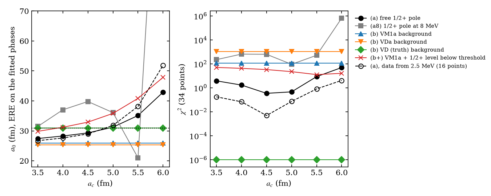

# The interior of a potential as the background of an R-matrix channel

**Status (2026-11-20): research, side branches `feature/upgrade-9-potential-background` and
`feature/upgrade-9-potential-capture` (the interior direct capture, section 5); not for merge without the PI's word.**
Built and tested in the engine as an option that is off unless a `potential` record has a `wave ... background
interior` field (and, for the capture, `capture interior` on it); no Sphinx page (the option is not for users yet; the
fields are listed, generated, in `reference/format3.rst`). Sections 1-6 are the design (5: capture, with its tests in
5.7); 7 what is built and its tests; 8 the radius experiment (synthetic: EXFOR was not reachable); 9 what is not done;
10 the PI's questions on ³He + ⁴He (R_pot poles, resonances, the scattering length); 11 the recommendation; 12 the
references and what was verified.

A channel of a pair with a `potential` record takes its exterior functions (P, S, φ) from the radial equation with a
nuclear potential acting between the channel radius a_c and the matching radius r_m (`hybrid_potential.rst`). This
note adds the interior half: the R-function of the same potential, obtained by integrating the radial equation from
the origin to a_c, is used as the background of that channel's diagonal R-matrix element in place of free background
poles; the fitted levels sit on top of it. With both halves from one potential and no levels, the channel's collision
matrix is that of the potential alone, whatever a_c is (section 2.3); with levels, a_c moves strength between the
levels and the potential. The note states the formalism in AZURE2's conventions (sections 1-2), the rule against
counting a state twice (section 3), what deep cluster potentials with Pauli-forbidden states do to it (section 4),
capture (section 5) and the scope and parameters (section 6).  Section 13 (branch `feature/upgrade-9-potential-gui`) is what the potential gives by
itself at low energy (its scattering length, effective range and bound states), the depth for a chosen scattering length
or binding energy, and the Qt panel that shows and tunes a pair's potential.

## 1. The interior R-function of a potential

For a pair α with reduced mass μ (MeV), charge numbers Z₁, Z₂, orbital angular momentum l and (with a spin-orbit term
or a J-dependent depth) total angular momentum J, at the c.m. channel energy E (MeV), the radial equation is that of
`hybrid_potential.rst`,

    u''(r) = (2μ/ħ²) [V_lJ(r) − E] u(r),   V_lJ = V_C + V_N,lJ + ħ² l(l+1)/(2μr²) + v_so ⟨2 l·i⟩.          (1)

Let u_E be the regular solution, u_E(r) ∝ r^{l+1} as r → 0 (V_C of a uniformly charged sphere is finite at the
origin, so the centrifugal term dominates there). Its logarithmic derivative at a_c (fm),

    ℓ(E) = a_c u_E'(a_c) / u_E(a_c)      (dimensionless),                                              (2)

defines, for a boundary-condition constant B (dimensionless), the interior R-function of the potential (Lane and
Thomas, Rev. Mod. Phys. 30 (1958) 257, single channel; Descouvemont and Baye, Rep. Prog. Phys. 73 (2010) 036301,
where the same quantity is computed with a Lagrange mesh, "the calculable R-matrix"):

    R_pot(E; a_c, B) = u_E(a_c) / [a_c u_E'(a_c) − B u_E(a_c)] = 1 / [ℓ(E) − B].                           (3)

R_pot is dimensionless, in the convention of AZURE2's R-matrix R_cc = Σ_λ γ_λc²/(E_λ − E) with γ in MeV^½
(`conventions.rst`). It is a meromorphic function of E with simple poles at the eigenvalues E_p of the potential in the
box [0, a_c] with the condition a_c u'(a_c) = B u(a_c), and residues

    R_pot ≈ γ_p² / (E_p − E),   γ_p² = (ħ²/2μa_c) u_p(a_c)² / ∫₀^{a_c} u_p² dr  (MeV),                      (4)

so that R_pot = Σ_p γ_p²/(E_p − E) exactly (the box eigenfunctions are complete on [0, a_c]). Equation (4) follows from the energy derivative of (2), dℓ/dE = −(2μ a_c/ħ²) ∫₀^{a_c} u_E² dr / u_E(a_c)²
(the Wronskian identity), which is negative: R_pot decreases between its poles like any R-function. The deep bound
states of a cluster potential, Pauli-forbidden ones included, are among the E_p (section 4).

Numerics: the Numerov recurrence of `IntegrateInward` (`physics/HybridPotential.h`, one function `NumerovNext` for
both directions) run outward on the same grid (the step closest to `step` that puts a_c on a node), started from
u(0) = 0 and u(h) = h^{l+1}, with the limit of g u at the origin where it is not zero (l = 1; l = 0 with a point
charge); the derivative at a_c by the same five-point difference. One V(r) (`RadialPotential`) serves both directions.
Accuracy O(h⁴): 7.5·10⁻⁷ relative for a 40-MeV well at Kh = 0.05 (section 7.2).

## 2. Where the background enters the engine's R-matrix

### 2.1 The level matrix with a background

AZURE2 computes, per J^π block, the level matrix (`physics/CollisionMatrix.h`)

    (A⁻¹)_λμ = (E_λ − E) δ_λμ − Σ_c γ_λc γ_μc L⁰_c,   L⁰_c = S_c − B_c + i P_c,
    U_cc' = Ω_c Ω_c' [δ_cc' + 2i P_c^½ P_c'^½ Σ_λμ γ_λc A_λμ γ_μc'],   Ω_c = e^{i(ω_c − φ_c)}.                 (5)

A background in channel c is a term R⁰_c(E) added to the diagonal element: R_cc = Σ_λ γ_λc²/(E_λ − E) + R⁰_c(E).
An energy-dependent R⁰_c is not a pole and has no place in the level sum. It is absorbed instead into the channel's
exterior functions. For one channel with R = R_L + R⁰, where R_L is the level part,

    1 − R L⁰ = (1 − R⁰ L⁰)(1 − R_L L̃⁰),   L̃⁰ ≡ L⁰ / (1 − R⁰ L⁰),                                           (6)

and the collision matrix U = Ω²(1 − R L⁰*)/(1 − R L⁰) becomes

    U = U⁰ + Ω̃² 2i P̃ R_L / (1 − R_L L̃⁰),   U⁰ = e^{2iω} (1 − R⁰L⁰*) / (1 − R⁰L⁰) · e^{−2iφ},                 (7)

with

    P̃ = P / |1 − R⁰ L⁰|²,   φ̃ = φ + arg(1 − R⁰ L⁰),   S̃ − B = Re L̃⁰,   Im L̃⁰ = P̃,   Ω̃ = e^{i(ω − φ̃)},     (8)

so that U⁰ = Ω̃² and U = Ω̃²[1 + 2i P̃ R_L/(1 − R_L L̃⁰)]. The multichannel case is the same with L⁰ diagonal: a
background on the diagonal of one channel factors out of that channel's column. Equation (8) is the whole effect:
**the background is a change of the channel functions (S, P, φ) → (S̃, P̃, φ̃) of the channel it acts on**; the level
matrix, the collision matrix, the T-matrix and every observable keep the form (5). In AZURE2 that is one place, the
channel functions of the pair at a_c.

The same statement on the waves: with H = G + iF the exterior outgoing solution at a_c and ρ = k a_c,

    H̃ = H − R⁰ (ρH' − B H),   ρH̃' = ρH' − B R⁰ (ρH' − B H),                                                  (9)

a real linear map of (u, ρu') with determinant 1, applied to F and G alike; it keeps the Wronskian, so P̃ = ρ/|H̃|²,
φ̃ = arg H̃ and S̃ = Re ρH̃'/H̃ follow from H̃ by the formulas the engine already uses
(`physics/ChannelFunctions.h`). The map acts on the values at a_c only; the waves at r > a_c (the external-capture
integrands) are unchanged (section 5).

### 2.2 The boundary condition of the background

R⁰ = 1/(ℓ − B) depends on B, and the split R = R_L + R⁰ is not invariant under a change of B: a Möbius transformation
of the sum is not the sum of the transforms. B is therefore a number of the background, B_bg, stated in the record,
not the channel's boundary condition of the levels. Once B_bg is fixed, L̃⁰ + B_bg ≡ ℒ(E) is a function of E alone,
and the levels on top see ℒ exactly as they see the exterior log-derivative without a background: the usual
B-invariance of R-matrix theory holds for the level part with ℒ in place of L. Below threshold the same map acts on
the decaying solution W̃: S̃ = B_bg + (S − B_bg)/(1 − R⁰(S − B_bg)) and W̃_d(a_c) = W̃(a_c)(1 − R⁰(S − B_bg)), which
continue P̃, S̃ analytically (S̃ is continuous through E = 0, section 7.2); the ANC ↔ γ factor of a level below
threshold uses W̃_d. At a bound state of the potential itself 1 − R⁰(S − B_bg) = 0: W̃_d vanishes, and a level placed
there with Brune's parameters gets γ = 0 (section 3). In particular

- **Brune's parameters** (Brune, Phys. Rev. C 66 (2002) 044611), the engine's default: the level matrix of
  `fill_level_matrix` reads S_c(E), S_c(E_λ), the chord between two levels and P_c(E); with the background these are
  S̃ and P̃. Brune's derivation uses only that S is a real function of E independent of B, which ℒ is. The on-resonance
  (observed) energy of a level is where (E_λ − E) − γ̃²(S̃(E) − S̃(E_λ)) vanishes, and its observed width
  Γ = 2P̃γ̃²/(1 + γ̃² dS̃/dE): the observed parameters are those of the resonance *on top of the background*, which is what
  a fit is compared with.
- **Formal parameters** (`--no-brune`): the channel's B_c and the formal (E_λ, γ_λ) relative to ℒ; B_bg ≠ B_c is
  allowed.
- **Park's parameters**: S̃'' as S''.
- **Conversion of observed to formal parameters**: the engine's `level_parameters` uses S, S', P at the level energy;
  it uses S̃, S̃', P̃ unchanged. A width read as observed from a fit without background and put into a project with
  background means a different reduced width: the observed width is that of the level on top of the background.

### 2.3 The identity

For a channel with no levels (R_L = 0), U = U⁰ = e^{2iω}(ℓ − L*)/(ℓ − L) e^{−2iφ}, independent of B_bg. If the
exterior functions come from the same potential (the hybrid pair), ℓ − L is the mismatch at a_c between the regular
interior solution and the exterior outgoing one, and U⁰ = e^{2i(ω + δ_pot)} with δ_pot the nuclear phase shift of the
potential (relative to the point-Coulomb phase), *whatever a_c is*. This is the identity the unit test checks
(section 7.2). It holds only when the exterior is the same potential: with a background from a potential and Coulomb
exterior functions, U⁰ is the phase of a potential cut off at a_c.

## 3. Counting a state twice

If a fitted level of the J^π block is also an eigenstate of the potential in that partial wave (a resonance or a bound
state the potential produces), R_pot already contains it as a pole near the level (Eq. (4)), and level plus background
would count it twice. Two rules, each stated in the record:

1. **Subtract the potential's pole.** R⁰ = R_pot − Σ_{p∈P} γ_p²/(E_p − E), with E_p the eigenvalue of the box problem
   with condition B_bg and γ_p² its residue (4), for the eigenstates p named by their node number n (0, 1, ...;
   n = the number of nodes of u_p inside a_c). R⁰ is then regular at E_p; the fitted level replaces the potential's
   pole. With the level at (E_p, γ_p) the potential alone is restored exactly. Consequence: E_p and γ_p depend on a_c
   and B_bg, so the "level on top" is a correction to the potential's state at that radius; its observed (Brune)
   parameters are the physical ones.
2. **Choose a potential with no state there**: a depth for which the partial wave has no eigenstate near the fitted
   level (for instance a potential fitted to the non-resonant part of the phase shift). No subtraction; the level
   carries the whole resonance.

Rule 1 is what the record does when it names `subtract`; rule 2 is the user's choice of depth. Rule 1 is checked
exactly (section 7.2): the potential's own p₃/₂ bound state, put on top of the p₃/₂ background as a level at its
energy and ANC with its box pole subtracted, restores the potential's phase shifts to 10⁻⁴° at a_c = 4.0 and 5.5 fm,
while its formal γ is 1.37 and 0.57 MeV^½: the observed parameters are radius-independent, the formal ones are not.
Without the subtraction, a level at a bound state the background already holds gets γ = 0 in Brune's basis (W̃_d
vanishes there), so this double counting is harmless; a level at another energy is not. A pole that is not
subtracted and lies close to a fitted level makes two poles of nearly equal energy in the channel: the fit then trades
widths between them and their observed parameters are not separately determined. The engine does not detect this.

## 4. Deep cluster potentials and forbidden states

Local potentials for two clusters that respect the Pauli principle bind the forbidden relative states (Buck,
Friedrich and Wheatley, Nucl. Phys. A 275 (1977) 246; Wildermuth's counting N = 2n + l < N_min). For ³He + α, N_min =
3: the s wave has two forbidden states (0s, 1s), the p and d waves one each (0p, 0d), the f wave none; the ⁷Be ground
and first excited states are the 1p states (one node). These are deep bound states of the potential (tens of MeV), and
they are eigenstates of the box too: R_pot has poles near them, at E_p ≈ their binding energies, far below the data.
For R_pot they are distant levels like any other, and they are needed: they fix the number of nodes of the scattering
solution inside a_c and hence ℓ(E) at the energies of the data (Levinson's theorem; the s-wave phase starts at 2π).
They are not subtracted (they are no fitted level) and they are not physical states of ⁷Be: nothing in the engine
reads them as levels. The physical bound states (1p) are poles of R_pot at energies near −1.59 and −1.16 MeV (for a
B_bg near S there); a project that fits them as levels must subtract them (rule 1) or leave the p wave without
background. For the potential VD the bound forbidden states lie at E_x = −33.0 (0s), −4.6 (1s), −2.1 and −1.0 MeV
(0d, 5/2⁺ and 3/2⁺); in a box of a_c ≈ 4 fm the 0d states appear as poles of R_pot 1-4 MeV below threshold with
θ² ≈ 0.3-0.9 (section 10.1): near threshold, not distant.

## 5. Capture

The engine's external capture (`ECIntegral.cpp`) has two parts for an entrance channel: the "hard-sphere" term, the
exterior wave cos φ F − sin φ G times the bound state from a_c to infinity, and channel capture, the outgoing wave
√P e^{−iφ} H⁺ fed through the level matrix. Both read φ and P at a_c from the channel functions and F, G at r > a_c
from the pair. With the background (8), φ → φ̃ makes the first term the exterior part of the potential's scattering
wave (cos φ̃ F − sin φ̃ G is that wave beyond a_c, up to normalization), and P̃, φ̃ in the second make the level part
consistent with (7). So the *exterior* capture is consistent with the background with no further change.

What was missing is the *interior* part of the direct capture of the potential's scattering wave, ∫₀^{a_c} u_f r^L u_E
dr, with u_f the bound state inside a_c. Without the background it is carried by the γ-widths of background poles;
with the background those poles are gone. Sections 5.1-5.6 are the design of the branch
`feature/upgrade-9-potential-capture`, which adds it as an option (`capture interior`); 5.7 its tests and numbers.

**The PI's approval (2026-11-20).** The two design points of 5.2 and 5.3 were put to the PI by the director as (1)
"box poles as levels with fixed particle and gamma amplitudes, interior wave driven by the full wave's surface term,
fitted levels keep their gamma widths, a subtracted box pole gives no capture" and (2) "bound-state shape from the
potential, normalisation from the fitted ANC, the potential must bind at the level's energy (refuse otherwise and print
the depth that would; no silent depth change), print the potential's own ANC next to the fitted one". His answer, 2026-11-20:
"Ok to both". The derivation below arrives at the same rules.

### 5.1 The surface term is the same for every wave the levels see

For a wave u of the channel with the values u(a), u'(a) at the channel radius, let

    D_u = ρ u'(ρ) − B_bg u   at ρ = k a_c   (the dimensionless surface term; u' = du/dρ).                (C1)

The dressing (9) leaves D unchanged: ρũ' − B_bg ũ = ρu' − B_bg R⁰ D_u − B_bg u + B_bg R⁰ D_u = D_u. With the levels on
top, the R-matrix relation of the channel at a_c is u(a) = (R_L + R⁰) D_u for the full wave, and the dressed waves
carry the level part alone: ũ(a) = u(a) − R⁰ D_u = R_L D_u. So the background's share of the full wave at a_c is
R⁰ D_u, with D_u computed from the actual (undressed) exterior wave or from the dressed one alike.

### 5.2 The entrance wave inside a_c (the model)

R_pot is a sum over the box states of the potential, R_pot = Σ_p γ_p²/(E_p − E) (Eq. (4)): in R-matrix terms each box
state is a level whose reduced width γ_p and interior wave function u_p (the box eigenfunction, ∫₀^{a} u_p² = 1) are
fixed by the potential, so its γ-ray amplitude into a final state is fixed too: the overlap of u_p with the final
state's interior wave. Driven by the surface term D of the full wave, these levels give the interior wave (Lane and
Thomas, the expansion of the interior solution in the box states; the sum is the potential's interior Green's function
at r' = a)

    u_bg(r) = D Σ_p γ_p² [u_p(r)/u_p(a)] / (E_p − E) = D g_E(r),
    g_E(r) = R_pot(E) φ_E(r) − Σ_{p∈P} γ_p² φ_p(r)/(E_p − E),   φ = u/u(a),                                  (C2)

where the first form of g_E is the closed sum (the regular solution at E, normalised at a, times R_pot: it solves the
radial equation and gives D at a_c) and P are the subtracted box states of rule 1 (section 3), whose capture belongs
to the fitted level that replaces them. g_E(a) = R⁰, so u_bg(a) = R⁰ D, the background's share of 5.1. **The model**:
inside a_c the entrance channel's wave is u_bg plus the fitted levels' interior wave functions; the latter are not
known (an R-matrix level has none) and their capture stays where it is today, in the levels' fitted γ-ray widths
(internal capture). The interior direct capture of the background is then the overlap of u_bg with the final state,
for both terms of the external capture:

- the hard-sphere term: its exterior wave X = cos φ̃ F − sin φ̃ G has X̃(a) = 0 (tan φ̃ = F̃(a)/G̃(a)), so the levels do
  not see it and X(a) = R⁰ D_X: inside a_c it continues as D_X g_E(r). Without subtraction this is X(a) φ_E(r), the
  potential's own regular solution: ρX'/X = 1/R⁰ + B_bg = ℓ(E) at a_c, so value and derivative are continuous, and
  with no levels the wave from 0 to ∞ is the potential's scattering wave (the identity of 5.7);
- the channel-capture term: its exterior is the outgoing wave H⁺ times the level-matrix factor; inside a_c the same
  factor times D_H g_E(r). With levels on top, the potential's interior is thus fed by the full wave, the incoming
  dressed part and the level-matrix-fed outgoing part, not normalised to the potential's phase shift alone.

Assumptions and what they cost: (i) the fitted levels' interior functions are not orthogonalised to the box states of
the potential; the interference between a level's own capture (its γ_γ) and the background's is the R-matrix's usual
one, through the signs and the level matrix. (ii) The split level/background depends on a_c and B_bg, as for the
elastic channel (section 2.2); only with no levels (or levels with zero widths) is the result a_c independent. (iii)
A subtracted box state's capture is set to zero in the background; the level that replaces it brings its own γ_γ.

### 5.3 The bound final state inside a_c (the rule)

The final state's exterior in the engine is W̃_f(r) times its ANC C (the hybrid pair's decaying solution, unit ANC,
`WhitFunc`), with C = γ_f N_f^{−1/2} (2μa/ħ²)^{1/2}/W̃_f(a) from the level's fitted γ_f (Brune) or its written ANC.
Inside a_c it is taken as

    u_f(r) = C W̃_f(a) φ_f(r),   φ_f = u_{E_f}/u_{E_f}(a)  the regular solution of the final partial wave's potential   (C3)

(the `wave` depth of (l_f, J_f), or the central one) at the level's energy E_f. Rule: **the potential must bind the
final partial wave at the level's energy**, its eigenvalue nearest E_f (`NearestEigenvalue`: the zero of the
Wronskian of the regular and decaying solutions at a_c) within 1 keV of E_f; otherwise the run is refused at set-up and
the message gives the depth (±30 % of the written one) that binds at E_f (`DepthBindingAt`). No depth is changed by the
engine. Within the tolerance, φ_f is integrated at E_f (its log-derivative then differs from the exterior's by the
small mismatch, which the set-up prints with the potential's eigenvalue). The normalisation is the level's: C W̃_f(a) at
a_c, so the shape inside comes from the potential and the size from the fit; the set-up note prints the potential's
own ANC, C_pot = [W̃_f(a)² (∫₀^{a} φ_f² dr + N_f)]^{−1/2} (N_f = ∫_a^∞ W̃_f²/W̃_f(a)² dr, the engine's), next to the
level's ANC as written, so that a level whose fitted ANC differs from the potential's is visible (then the interior is
the potential's shape scaled to another norm: the model is not a normalised two-body state; the internal capture of
the final level is not changed). Refused: an unbound final state (no interior outgoing wave is built), and as before a
final state in a background partial wave (its decaying solution with the background is not built).

### 5.4 The integral and where it enters

With the weight w(r) of the multipole (r^L, times the finite-wavelength charge function when the long-wavelength
approximation is off; r^0 for M1), the kernel (`physics/` `InteriorCaptureIntegral`)

    K(E) = ∫₀^{a} φ_f(r) w(r) g_E(r) dr   (fm^{L+1})                                                       (C4)

on the Numerov grid of `IntegrateOutward` (both waves on one grid, a on a node), Simpson's rule (3/8 on the last three
intervals when their number is odd), O(h⁴). The engine's radial integrals of the exterior, FW = ∫_a^∞ F W̃_f w dr and
GW, get the interior parts

    FW += K D_F W̃_f(a),   GW += K D_G W̃_f(a)   (D of the undressed F, G at a; for a closed entrance channel GW +=
    K W̃_i(a)(S_i − B_bg) W̃_f(a)),                                                                            (C5)

in the scale the integrals carry (the Whittaker decades of `ECIntegral`). Both external-capture terms are linear in FW
and GW (cos φ̃ FW − sin φ̃ GW and GW + i FW), so (C5) gives each its interior of 5.2, and the factors applied after
(the effective charge, the angular coefficients, γ_f N_f^{−1/2} K_c, the level-matrix factor) apply to it unchanged.
One place: `ECIntegral::AddInteriorCapture`, called after the exterior integration in the open and the closed branch;
the energy tables (`ECTable`) and the reaction-rate grid tabulate or sum the same integrals.

**Operators.** E1 and E2 with the engine's effective charge (Z₁(m₂/M)^L + Z₂(−m₁/M)^L in the long-wavelength form, the
charge function otherwise): the same weight as the exterior. M1 (r^0, the orbital and spin factors applied after) comes
with the same code: the interior overlap of the background's wave with the bound state; it is not zero when the two
partial waves have different potentials. Tested: E1 (5.7), E2 and M1's orbital term (5.12). Not covered: an unbound final state, a final state in a
background wave (both refused), two spinning particles in the pair (as for the background), M1 and E2 against an
independent calculation.

**Gradient.** K depends on the energies and the potential only. The interior part enters the same integrals the
exterior does, which the amplitudes multiply by γ_f N_f^{−1/2} (the final state's fitted ANC) and, for channel capture,
by the level-matrix factor: the adjoint already differentiates those factors and reads the integrals as constants. So
the analytic gradient needs no change; checked with `AZURE_GRAD_CHECK` (5.7).

### 5.5 The record

    wave l <l> [J <J>] [depth <V> MeV] [width <r0> fm] background interior boundary <B> [subtract <n>] capture interior

on each entrance partial wave whose background is to capture; the final partial wave (l_f, J_f) needs no field (its
depth, if it has its own, is a `wave` without background; with `only bound_state` that depth gives the bound-state
shape alone and the wave's channel functions stay point-Coulomb, section 5.9). Absent: nothing changes (the potential's key, every output,
the tests; 5.7). `capture` without `background` is refused (`E_POTENTIAL_WAVE`).

### 5.6 Cost

Per external-capture integral two outward Numerov integrations over [0, a] (about 150 nodes each) and one Simpson sum,
plus, with a subtracted pole, the box-state search of the background (as for the elastic channel, section 8). The
energy tables evaluate the integral at their nodes only.

### 5.7 Tests and results

**The identity (the heart).** `tests/potential_capture/check.sh`: 3He(α,γ)7Be as a pure potential model in the engine
(the Gaussian potential VD of Tursunov et al., section 10, in both halves; the s1/2, d3/2, d5/2 entrance waves with
`background interior boundary 0 capture interior`; the potential's own p3/2 and p1/2 bound states as the final
states, at the potential's energies and ANCs; the entrance J^π groups with one zero-width level each at 40 MeV; E1,
long-wavelength operator) against a direct potential-model calculation that does not use the engine
(`make_reference.py`: scipy DOP853 for the scattering and bound waves, mpmath's Coulomb and Whittaker functions, the
overlap integrals from 0 to ∞, the E1 formula of Tursunov et al. Eq. (8), which the script's formula equals term by
term). With the engine's masses the VD p3/2 depth binds at B = 1.4548867432 MeV with C = 4.0931604450 fm⁻¹ᐟ², the p1/2
at 1.0371757516 MeV, C = 3.5000439504 fm⁻¹ᐟ²; the project's threshold is put at the former (7Be(3/2⁻) at E_x = 0, the
1/2⁻ at 0.4177109916 MeV). σ into each state at E_cm = 0.02, 0.05, 0.1, 0.2, 0.3, 0.5, 0.7, 1, 1.5, 2, 2.5, 3 MeV:

| a_c (fm) | 3.5 | 4.0 | 4.87 | 5.5 |
|---|---|---|---|---|
| with `capture interior`: largest \|σ/σ_ref − 1\| (24 values) | 1.3·10⁻⁷ | 6.7·10⁻⁷ | 8.5·10⁻⁸ | 1.3·10⁻⁷ |
| without it (the exterior alone): largest \|σ/σ_ref − 1\| | 0.112 | 0.089 | 0.228 | 0.445 |
| without it, σ(3/2⁻)/σ_ref at 20 keV and 3 MeV | 1.068, 1.106 | 1.064, 1.039 | 0.996, 0.772 | 0.917, 0.555 |

The four radii agree with each other to 5.6·10⁻⁷ (the largest values come from the energy tables' interpolation at
4.0 fm; the rest are 10⁻⁷). Without the interior part the result depends on a_c by 15 % at 20 keV and by a factor 2 at 3
MeV, and the interior part enters with either sign (it adds at 5.5 fm, subtracts at 3.5 fm): the test can fail, and the
interior capture is not a small correction in this model. The set-up note gives the potential's eigenvalues 0.48 and
0.43 eV from the levels' energies (Numerov against DOP853) and the potential's own ANCs 4.09316 and 3.50004 fm⁻¹ᐟ², equal
to the written ones (an independent check of the ANC formula of 5.3).

**S34(0) of the model.** S(E) = E σ e^{2πη} of the reference: 0.4759, 0.4654, 0.4483 keV b at 20, 50, 100 keV (sum of
both states); a quadratic through these three gives S(0) = 0.483 keV b (0.339 into 3/2⁻, 0.144 into 1/2⁻; a cubic
through four points 0.4831). The engine gives the same to the digits above. This is the S factor of VD with the
projects' masses, which bind the p3/2 state at 1.455 MeV, not at 7Be's 1.5866 MeV (section 9): it is not the paper's
model. With the paper's constants (`make_reference.py --paper`: ħ²/2u = 20.7343 MeV fm², nuclear masses
4.001506179127 u and 3.0149322473 u) the same script gives B = 1.58661 and 1.16083 MeV and C = 4.345 and 3.715 fm⁻¹ᐟ²,
the paper's 1.5866 and 1.16082 MeV and 4.34 and 3.71 fm⁻¹ᐟ² (its section III.A), and S = 0.508, 0.354, 0.275, 0.256,
0.261, 0.298 keV b at 0.02, 0.5, 1.0, 1.5, 2.0, 3.0 MeV (E1), S(0) = 0.516 keV b by the same quadratic. The paper
gives no number for S(0) of VD; its Fig. 6(a) (the VD curve, read from the figure, about ±0.01 keV b) runs from about
0.51 keV b at the lowest energy through 0.28 at 1 MeV and 0.26 at 1.5-2 MeV to 0.33 at 3 MeV, where its E2 resonance
(about 0.03 keV b in its Fig. 4) adds to the E1 shown here: the reference agrees with the paper's model to the
precision a figure can be read. That comparison checks the reference; the engine is checked against the reference.

**Kernel against closed forms** (`physics_potential_capture`, ctest): for the zero potential (free waves, the l = 1
regular solution below threshold in closed form), K of Eq. (C4) to 3·10⁻⁹ at a = 4.0 fm (even number of intervals) and
4.87 fm (odd: the 3/8 rule), B = 0 and −1; with the lowest box pole subtracted, against the closed-form pole term, to
1.2·10⁻⁶. The bound-state rule on VD p3/2: the eigenvalue from the Wronskian at a_c = 3.5, 4.0, 5.5 fm is scipy's to
5·10⁻⁷ MeV; `DepthBindingAt` returns the written depth at that energy to 2.4·10⁻⁸ relative, and 84.129571 MeV binds the
p3/2 wave at 1.5866 MeV with the projects' masses.

**The refusal.** With the p3/2 depth 83.65 MeV in place of 83.589554 the potential binds 3/2⁻ 14.6 keV below the
level: the run stops at set-up ("ERROR: ... binds that wave at −1.46952706 MeV, −14.64 keV away (tolerance 1 keV). The
depth that binds it at E_f is 83.58955202 MeV ..."), the written depth to 2·10⁻⁸.

**Gradient.** `tests/potential_capture/models/fit_level.azr.in` (a 1/2⁺ level at E_x = 3 MeV on top of the s-wave background, its particle and γ
widths and the ground state's ANC free, nine made-up capture points): `AZURE_GRAD_CHECK` gives the analytic gradient
equal to central differences to 2.7·10⁻¹⁰ relative on the three parameters (the level-matrix feed and the ANC both
reach the interior part through factors the adjoint already has), the Jacobian path to 3·10⁻¹⁵.

**Nothing moves without the field.** `capture` is part of the potential's key only when set; the code path
(`AddInteriorCapture`) returns at once for a wave without it. `ctest -LE slow` and `tests/run_tests.sh`: HANDOFF (2026-11-20, potential-capture).

### 5.8 The energy table through a pole of R_pot (a defect of the parent branch, fixed)

Reported on another project (2026-11-20): with a background in the s and d entrance waves and no level with a width
there, the ³He(α,γ) capture at a_c = 4.87 fm agreed between B_bg = 0 and B_bg ≈ S(E_pole) up to E_cm ≈ 5 MeV and
differed erratically above (ratios 0.93 ... 166), while it must not depend on B_bg; with `--no-ec-table` the two
agreed. The cause is the external-capture energy table (`ECTable`), not the integrals: it tabulates the integral
divided by a factor of the entrance channel at a_c, √P for the hard-sphere term and e^{−iφ} for channel capture, and
interpolates the quotient in ln E. With a background those factors were the dressed ones. At a pole of R⁰ (a box state
of the potential: for VD at a_c = 4.87 fm the s wave at E_cm = 7.591 MeV with B_bg = 0 and 7.673 MeV with −0.05; at 5.5
fm the s, d5/2, d3/2 waves at 5.14, 7.02, 7.53 MeV with B_bg = 0, by scipy) H̃ = H − R⁰(ρH' − B_bg H) passes through
infinity: P̃ = ρ/|H̃|² → 0 and φ̃ jumps by π, and the hard-sphere integral (cos φ̃ FW − sin φ̃ GW) changes sign with it.
The quotient diverged and changed sign there, R⁰ ∝ 1/(E − E_p) bent it over several per cent of E around the pole, and
the 8-point Lagrange stencil returned numbers off by up to a factor 50. The physical amplitudes are smooth through the
pole: the amplitude carries e^{−iφ̃} times the integral (invariant under φ̃ → φ̃ + π), and channel capture √P̃ e^{−iφ̃} =
√ρ/H̃, which passes smoothly through zero.

**Fix** (first, e4e92530): for an entrance wave with a background the table divided by factors of the undressed waves,
smooth through a pole of R⁰. That was not enough (review, 2026-11-20, 5.10 finding 1): across a narrow resonance of
the potential the amplitude itself turns within a few keV, below the spacing of the table's nodes (50 per decade, 13 keV
at 0.3 MeV), and the table was up to 21 % off there. **Now** (`ECTable.cpp`): an entrance wave with an interior
background is integrated directly at every energy, never from the table, so table on and off give the same numbers for
it (to the last digit); every other wave keeps the table as before. The signature of `intEC.dat` gets a mark for a pair
whose potential has a background ("background direct v3"), so a file of an earlier table is recomputed; no other
signature changes. Cost: the capture of the 24-energy model of 5.7 takes the same time with the table off as on (the
table's nodes are integrals too); a fit with many folded points pays one integral per sub-point for those waves.

**Numbers** (`tests/potential_capture`'s model, E_cm = 0.02-9 MeV, B_bg = 0 against s −0.05, d −0.27; a_c = 4.87 fm):

| | before (parent's table) | after |
|---|---|---|
| with `capture interior`, σ(B_bg ≠ 0)/σ(B_bg = 0), table on | 1.000000 to 6.0 MeV, then 1.094 (6.5), 0.327 (6.75), 0.148, 0.722, 0.048 (7.5), 0.019 (7.75), 0.168, 0.134, 0.101, 3.15, 3.43 (9 MeV) | 1 to 2·10⁻⁶ |
| the same without `capture interior` | 1.036 (6.5), 0.603, 0.416, 0.875, 0.103, 0.048 (7.75), 0.292, 0.216, 0.166, 2.73, 3.39 | identical (0) |
| table on against `--no-ec-table` | off by the same factors above 6 MeV (B_bg = 0 too) | 2.1·10⁻⁶ (capture), 3.1·10⁻⁶ (without) |
| `--no-ec-table`, B_bg ≠ 0 against 0 | identical | identical |

(With the direct integrals of the later fix, below, check.sh gives the reference to 3.1·10⁻⁶ over 0.02-9 MeV at the four
radii, the radii to 3.2·10⁻⁶, B_bg ≠ 0 and table off to 6.9·10⁻⁷: the direct integrals' tolerance, 10⁻⁴ nominal.)
Over the grid a_c = 3.5, 4.0, 4.87, 5.5 fm × the two B_bg × table on/off with `capture interior`, every σ agrees with
every other to 2.1·10⁻⁶ and with the independent reference (`make_reference.py`, extended to 9 MeV) to 1.6·10⁻⁶; close to the poles (E within 10⁻¹¹ to 10⁻⁴ MeV of 7.591485 and
7.673467 MeV at 4.87 fm) the capture is smooth and B_bg- and table-independent to 8·10⁻⁷.

**The elastic channel functions are not affected**: they are evaluated at each energy, never interpolated. The s-wave
phase shift at a_c = 4.87 fm through both poles (E = 7.5914 ... 7.5915 and 7.6734 ... 7.6735 MeV, down to 10⁻¹¹ MeV from
the poles) is identical between B_bg = 0 and −0.05 to all printed digits (11) and smooth (−82.4557° at the first pole,
−83.0458° at the second; −85.35° at 8 MeV, the potential's). Exactly at a pole, to the last bit, 1/(ℓ − B_bg) would
divide by zero and the dressed waves would be infinite; a computed energy does not land there in practice (the nearest
tested, 10⁻¹¹ MeV away, is smooth), and it is not guarded.

### 5.9 A potential for the bound-state shape only (`only bound_state`)

**Why.** The rule of 5.3 takes the final state's interior shape from the potential of its partial wave, so that wave
needs a depth that binds the level. A `wave` depth also changes the wave's channel functions beyond a_c (the hybrid
exterior): in a project whose final-state waves also carry ordinary fitted levels and background poles in the elastic
channel, giving them the binding depth changed their elastic description (a test on an evaluation project: the
elastic χ² rose by about a factor four with the model otherwise the same). The two roles of a wave's potential are
separated by an opt-in qualifier (announced to the PI by the director as a refinement of point 2 of the approval of
2026-11-20; no objection).

**The record.**

    wave l <l> [J <J>] [depth <V> MeV] [width <r0> fm] only bound_state

(key `only`, value `bound_state`). Refused (`E_POTENTIAL_WAVE`) together with `background` on the same wave (a
background acts on the channel functions), and when no wave of the same potential has `capture interior` (it would
then do nothing). Absent: nothing changes (the key enters the potential's key only when set; every existing output is
the same bit for bit).

**What it does (decided).**

- The wave's channel functions are the point-Coulomb ones, exactly as if the pair had no potential in that wave: the
  waves F, G at a_c (`CoulFunc`), the shift function below threshold (`ShftFunc`) and the decaying solution W
  (`WhitFunc`, so also the ANC ↔ γ conversion of its levels and N_f of external capture). Its levels, its elastic
  phase shifts and anything else the channel enters are those of the model without a potential in the wave.
- External capture into a final state of such a wave: beyond a_c the point-Coulomb Whittaker function times the
  level's (fitted) ANC, as for a pair without a potential. Inside a_c the potential's eigenfunction of that wave
  (`ForPartialWave`: its depth and width), normalised so that its value at a_c continues the exterior's. The value is
  continuous at a_c, the derivative is not: the interior is the potential's, the exterior is Whittaker's, and they
  match only where the potential is negligible beyond a_c. The set-up note gives both log-derivatives at a_c.
- The bound-state rule of 5.3 holds with the potential's own eigenvalue (the potential from 0 to ∞, its own exterior):
  within 1 keV of the level's energy, else the run is refused with the depth that would bind. The note's "own ANC" is
  that of the potential's normalised eigenstate with its own exterior (`PotentialBoundStateANC`), next to the level's
  ANC as written.
- The entrance waves (with `background interior ... capture interior`) are unchanged.

**What this costs in consistency.** With the potential in the final wave (5.3) the final state is, at the potential's
ANC, exactly the potential's normalised bound state; with `only bound_state` it is the potential's interior joined to
the Whittaker tail at a_c with a kink, so the identity of 5.7 holds only as far as the p-wave potential beyond a_c is
negligible. Measured on the model of 5.7 (VD, p waves `only bound_state` against the potential in them, same ANCs):

| a_c (fm) | 4.0 | 4.87 | 5.5 | 7.0 | 8.0 |
|---|---|---|---|---|---|
| largest \|Δσ/σ\| of either state, 0.02-9 MeV | 0.18 | 0.068 | 0.025 | 1.0·10⁻³ | 7.5·10⁻⁵ |
| total σ at 20 keV, ratio | 0.9975 | 1.0024 | 1.0015 | 1.0001 | 1.0000 |
| total σ at 3 MeV, ratio | 1.0218 | 1.0159 | 1.0075 | 1.0005 | 1.0000 |

At 4.0 fm the interior shape's a u'/u at a_c is −1.256 (3/2⁻) and −1.109 (1/2⁻) against −2.215 and −2.076 of the
point-Coulomb exterior. Near threshold (S(0)) the difference is a few 10⁻³; it grows with energy.

**Tests** (`tests/potential_capture/check.sh` section 7, synthetic models only): (a) with the p waves `only bound_state`
and two p-wave levels with widths on top of the bound ones, the p-wave phase shifts (26 values, 0.1-9 MeV) and the
p-wave levels of `parameters.out` are identical, to every printed digit, to those of the same levels with no
potential (both without the Coulomb table, so that one Coulomb routine serves both); without the qualifier they differ
(the check bites); (b) the capture equals that with the potential in the p waves to 7.5·10⁻⁵ at a_c = 8 fm and
differs by 6.8·10⁻² at 4.87 fm; (c) a depth off the level is refused with the binding depth 83.58955202 MeV, and the
note gives the potential's own ANC 4.09316 fm⁻¹ᐟ² (scipy: 4.0931604450) and the two log-derivatives; (d)
`--validate` accepts the record, `--describe` shows it (the waves of a potential are now listed, one line each, only
for a potential that has them), and pyazr opens and saves the project byte for byte. `--convert` takes old formats
only (a format-3 file is refused as "already format 3"), so there is nothing to convert. `experiment_build` has the
field's cases (reaches the wave; refused without a capture interior and with a background).

### 5.10 An independent review (2026-11-20) and what was changed

The director's review of the branch (its models and scripts in the research directory) named the following; each was
checked here before it was changed.

1. **The energy table across a narrow resonance of the potential** (reproduced: an s1/2 depth of 100 MeV puts a
   resonance about 20 keV wide at E_cm = 0.30 MeV; table on against off up to 21 % apart, table off against the
   reference 4.4·10⁻⁵): fixed by integrating a background wave directly (5.8). Test: check.sh section 8, table on =
   table off to every digit and both = `make_reference.py --s-depth=100` (`data/reference_narrow.csv`) to 5.1·10⁻⁵ (the Numerov error, magnified by the resonance).
2. **A closed entrance wave with a background** (by reading; confirmed): the closed branch of `ECIntegral` normalised
   the decaying wave by W̃(a), the levels see W̃_d(a) = W̃(a)(1 − R⁰(S − B)) (the ANC ↔ γ factor reads it). Fixed for
   the exterior and the interior part alike. Test: check.sh section 9, a second pair 3He + 4He(2.0 MeV) with an s-wave
   background and capture interior, all capture through its channel: continuous through its threshold (σ = 2.05973 and
   2.06086·10⁻¹² b at E_cm = 1.9999 and 2.0001 MeV, the slope of its neighbours); with W̃(a) it jumped by a factor 2.44.
3. **The API for a GUI**: `channel_functions` asks for J when a `wave` names J (it took 2J = −1 before and ignored the
   J-specific depths and backgrounds); F, F', G, G', P, S and the phase are now all the dressed ones in a background
   wave (before, F, G and the phase were undressed while P and S were dressed; the test checks P = ρ/(F² + G²) and
   δ = −atan2(F, G) on the returned set); `nuclear_potential(pair).waves` lists the `wave` fields;
   `Session.potential_box_states(pair, l, J, radius, boundary, e_min, e_max)` gives E_p, γ_p² and the node numbers;
   `Session.potential_bound_state(pair, l, J, energy, window)` the potential's eigenvalue and its ANC (both rows of
   `Session.describe()["functions"]`, so the web page's Physics tab draws them). The potential's own scattering length
   followed on `feature/upgrade-9-potential-gui` (section 13: `Session.potential_scattering_length`). Test:
   `pyazr_potential_api`.
4. **`describe`**: the text lists the waves (5.9) and the JSON block has `waves` (only for a potential that has them).
5. **The NaN step of an LM fit** (the reported abort, on the evaluation project): its exact cause was not found here
   (the project is not used). Two places that give NaN at a pole of R⁰ are now defined: exactly on a pole the
   denominator a u' − B u rounds to zero and R_pot was infinite, which the dressing turned into NaN (inf/inf) -- now
   R_pot is taken one representable energy above, finite (|R| ≈ 10¹³ for VD's s wave); and W̃_d/W̃ was 1/(1 + R⁰(S̃ −
   B)), where S̃ − B ≈ −1/R⁰ is lost to rounding against B near a pole -- now 1 − R⁰(S − B) with the undressed S. With
   the guard of the parameter vector (HANDOFF, follow-up 2) a non-finite step is rejected, not evaluated. Test:
   `physics_potential_capture` evaluates exactly at a bisected pole (E_p to the last bit): R_pot, the dressed waves
   and W̃_d/W̃ finite.
6. **Smaller points.**
   - The node count of a box state missed a sign change in the last interval (r_{n_a−1}, a): counted now. The node
     numbers of the tests' states did not change (tests/potential_background passes as before).
   - **Near a subtracted pole** R_pot and γ_p²/(E_p − E) cancel; the residual error is about γ_p²(δE_p/x² + δγ_p²/x),
     x = E − E_p. E_p is now bisected to the last bit (was 10⁻¹¹ MeV), and within 1 keV of E_p R⁰ (and the capture
     kernel) is the straight line between its values at ±1 keV: continuous there to 4·10⁻⁹ of R⁰ (the test: 1 eV inside
     the window's edge against the edge), exact at E_p by construction. Outside the window the error is below
     10⁻⁷ γ_p² for δE_p ≈ 10⁻¹⁵ MeV and δγ_p²/γ_p² ≈ 10⁻¹⁰ (Richardson). The capture kernel's subtracted part is
     γ_p² I_p/(E_p − E) with a constant overlap I_p: (K − K_sub)(E_p − E) is the same at three energies to 1e-6 (test).
   - The label of the written ANC: a level given by its reduced-width amplitude (the row's flag) is said to be so,
     not printed as an ANC.
   - The 1 keV binding rule and its note apply only to a final channel that a wave with capture interior reaches by a
     multipole of the photon pair (E1: |l_i − l_f| = 1; M1: l_i = l_f; E2: |l_i − l_f| = 2 or l_i = l_f > 0).
   - Set-up (`CheckPotentialWaves`): `subtract n` naming a state the box does not have is refused when the project is
     set up (before, at the first evaluation); a background on a channel whose radius lies beyond the matching radius
     (where it would not act) is refused; a `wave` whose (l, J) is no channel of its pair is warned about.
7. **A behaviour change outside the potential**: a parameter file with a non-finite value is refused for every model
   (HANDOFF, follow-up 2); listed there for the owner.

The end-to-end test of `subtract` with capture, left open in this round, is section 5.11.

### 5.11 A subtracted pole put back as a level: the photon amplitude, and the end-to-end identity

**The engine's conventions** (`physics/CollisionMatrix.h`, `src/ChannelTables.cpp`, `src/UnitExternalCapture.cpp`,
`src/ECIntegral.cpp`). A photon channel has √P_γ = (E_γ/ħc)^{L+1/2} and phases 1. For an entrance channel c with
Ω_c = e^{iω_c} e^{−iφ̃_c} and the level matrix A of its J^π group:

    internal capture       T_int = −Ω_c 2i √P̃_c √P_γ Σ_λμ γ_λc A_λμ γ_μγ,
    hard-sphere term       T_hs  = Ω_c √P_γ s_f a_X f ∫ X ū_f w dr,   X = cos φ̃ F − sin φ̃ G,
    channel capture        T_cc  = Ω_c √P_γ s_f I_cc 2i √P̃_c Σ_λμ γ_λc A_λμ γ_μc',                          (C6)

with s_f = γ_f N_f^{−1/2} K_c (the final state's ANC), f = FluxFactor/√(ħc) = (μ/2E)^{1/4}/√(ħc), a_X the multipole's
charge and angular factor of `CalculateDirect` (E1: −i √(αħc) Z_eff √48/3 i^{l+1−l_f} ⟨l 0 1 0|l_f 0⟩ √(2l+1)
√(2J_f+1) W(1 l_f J l; s J_f)), I_cc the channel-capture integral and ū_f the final state's interior and exterior in
the integrals' scale. T_cc has the form of T_int with γ_μγ → γ^ext = −s_f γ_μc' I_cc (`external_reduced_width`).

**The box state's photon amplitude.** In the unsubtracted model the interior wave of pole p is γ_p² φ_p(r) D/(E_p − E)
(Eq. (C2)), D the surface term of the full wave. With a level λ = p in the level matrix (formal, B_c = B_bg) on the
background with p subtracted, the dressed waves give: the hard-sphere wave X̃ vanishes at a_c, so the full wave's
surface term is D = D_X'/(1 − R_L L̃), D_X' = cos φ̃ D_F − sin φ̃ D_G = ρ/|H̃| = √(ρ P̃) (the Wronskian), and the level's
share is γ_p D/(E_p − E) = A γ_p √(ρP̃). The pole's capture in the units of T_hs is therefore
Ω_c √P_γ s_f a_X f A γ_p² √(ρP̃) ∫ φ_p ū_f w; equal to T_int when

    γ_pγ = (i/2) (√(μ a)/ħc) a_X γ_p J_p,   J_p = ∫_0^a φ_p(r) u_f(r) w(r) dr,                                (C7)

using f √ρ = √(μa)/ħc (independent of E), u_f = s_f ū_f the normalised bound state (C W̃(a) φ_f inside a_c) and φ_p =
u_p/u_p(a). (C7) is the engine's closed-channel integral (`CalculateDirect`, E < 0) with the decaying wave over its
value at a_c replaced by the box state over its value at a_c: −s_f γ_p I_cc with I_cc = a_X (−i/2) (√(μa)/ħc)
∫ φ_p ū_f w. For E1 (s → p) it is real.

**Brune's parameters.** For one level, E_p − E − γ_p²(S̃(E) − B_bg) = (E_b − E) − γ_p²(S̃(E) − S̃(E_b)) with E_b the root of
E_p − E_b − γ_p²(S̃(E_b) − B_bg): Brune's amplitudes are the formal ones (γ̃ = γ, the particle's and the photon's), and only
an observed width carries 1/(1 + γ̃² S̃'(E_b)). The engine reads a photon width as the observed total of the internal
and the complex external amplitude at E_b and subtracts the latter (`subtract_external_capture`): g_int = sign(g)
√(g² − Im² g_ext) − Re g_ext.

**What holds, and the test** (check.sh section 10; `make_subtract_level.py` writes the model; synthetic). The model of
section 9 at a_c = 4.87 fm, B_bg = 0: the s-wave box state with 2 nodes (E_p = 7.5915 MeV, γ_p² = 1.6465 MeV)
subtracted and replaced by a 1/2⁺ level at E_b = 9.874 MeV (E_x = 11.3289 MeV), Γ_p = 18.845 MeV (observed, from
the dressed S̃, P̃ of the subtracted background), and photon amplitudes from (C7) with J_p by scipy (0.34322 MeV^½ into
3/2⁻, −0.25082 MeV^½ into 1/2⁻). The two models agree to 3.2·10⁻⁷ in the capture into both states (0.02-9 MeV) and to
1.4·10⁻⁶° in the s-wave phase shift: **the identity holds exactly** (to the numerics) in this design, in which the
subtracted pole gives no interior capture and the level that replaces it carries its γ-ray amplitude. Without the
level's photon widths the capture misses by 8-15 %, and without the level by more. A first attempt put γ̃_γ =
γ_γ/(1 + γ²S̃')^½ in Brune's basis; the capture then missed by 2-6 %, and one factor, 0.8182 = (1 + γ_p²S̃')^½, fitted
at every energy and both states: the structure of (C7) is right, the factor was the convention of the previous
paragraph.

### 5.12 E2 and M1 through the interior capture

The interior capture is one code for every multipole the engine's external capture has: the weight w(r) = r^L (times
the charge function without the long-wavelength approximation) for EL, r⁰ for M1, and the factors applied after the
integrals (the effective charge, the angular coefficients, M1's orbital and spin terms) are those of the exterior. It
is checked against an independent calculation (`tests/potential_capture/make_reference_e2m1.py`: scipy and mpmath,
the golden rule with Edmonds' reduced matrix elements of e Z₂ r² Y₂ and of √(3/4π) μ_N g_l **l**) on a synthetic
model (check.sh section 11, `models/e2m1.azr.in`): the final state is VD's bound 0d5/2 state (B = 3.68047 MeV,
C = 2.50868 fm⁻¹ᐟ²) in a d5/2 wave with `only bound_state`, the s1/2 and d3/2 waves with capture interior (a_c = 4 fm),
E_cm = 0.5-4 MeV.

| pathway | engine against the reference |
|---|---|
| E2, s1/2 → d5/2 (interior + exterior) | 1.5-2.5·10⁻⁷ |
| E2, d3/2 → d5/2 | 0.1-5·10⁻⁷ |
| M1 (orbital), d3/2 → d5/2 | 1.2·10⁻⁷-2·10⁻⁶ |
| E2, M1 d5/2 → d5/2 (the final state's own wave: exterior only), final ANC 10⁻³ | 10⁻⁶ |
| the same at the state's own ANC 2.509 fm⁻¹ᐟ² | 0.86-0.93 (E2), 0.76-0.80 (M1) |

The last row is not the interior capture: the final level is also an R-matrix level of its own d5/2 channel (its ANC
gives it a reduced width), and its pole changes the d5/2 scattering wave and adds channel capture through it, which
the reference's hard-sphere wave leaves out; with the ANC at 10⁻³ (the pole's effect ∝ C⁴, the capture ∝ C²) the two
agree to 10⁻⁶, and the test runs at that ANC. Not checked: M1's spin term (the pair's g factors are 0 in the model),
E2 without the long-wavelength approximation (the charge function; the default is the long-wavelength form), and E1
or E2 from a wave whose final state lies in the same partial wave (refused: a final state in a background wave).

## 6. Scope, parameters, validity

- **Channels**: particle channels of a hybrid pair (a pair with a `potential` record); tested on single-channel elastic
  partial waves (the entrance channel of a capture reaction is the next case). The background
  is per partial wave (l, and J where the potential depends on J), on the diagonal; with one spinning particle the
  channel spin is fixed by (l, J) and the background is diagonal in the channels (as the spin-orbit term,
  `spin_orbit_potential.md` §2.2). Below threshold the shift function and the ANC factor are dressed (section 2.2); an
  external-capture final state in a background partial wave is refused (section 5).
- **What is fixed and what is fitted**: the potential (depth per partial wave, range, R_C) and B_bg are fixed numbers of
  the record; the levels on top are fit parameters as usual. The engine has no potential parameter in the fit vector
  (decided 2026-11-10, `spin_orbit_potential.md` §6 Q7): a depth is fitted by a scan with refits (a profile), which is
  what section 8 does. The gradient of the levels is unchanged (the background changes channel functions, which the
  adjoint reads as constants of the parameters).
- **Partial-wave dependent potentials**: published cluster potentials for ³He + α use a depth (and some a Gaussian
  range) per (l, J) (Dubovichenko, arXiv:1006.4944, Table 3.1; Tursunov et al., Tables I and II). The record takes
  both per partial wave (`wave ... depth ... width ...`), acting in both halves, so that one potential gives both.
- **Validity**: the identity (2.3) is exact for the pure potential problem. With levels, R_L + R⁰ is a model: the
  potential describes the non-resonant interior, the levels what the potential lacks. The a_c dependence that remains
  comes from the levels and from the missing interior capture; it is measured in section 8.

## 7. What is built

### 7.1 Code (branch `feature/upgrade-9-potential-background`)

- `physics/HybridPotential.h`: `IntegrateOutward` (the inward integration's Numerov recurrence, now one function
  `NumerovNext` for both directions; the regular start u(h) = h^{l+1} with the limit of g u at the origin for l = 1
  and for a point charge), `InteriorLogDerivative`, `InteriorRFunction` (Eq. (3)), `InteriorBoxStates` (E_p, γ_p²,
  node numbers, Eq. (4)), `BackgroundR` (R⁰ with the named box states subtracted), `DressWaves` (Eq. (9)),
  `DressShift` and `ChannelBoundShift` (S̃ below threshold), `BackgroundWFactor` (the ANC factor below threshold),
  `PartialWave` (a depth, a Gaussian width and a background per (l, J)), `ForPartialWave`, `BackgroundOf`,
  `DependsOnJ`, `BelowThresholdPotential`.
- The record: `wave l <l> [J <J>] [depth <V> MeV] [width <r0> fm] [background interior boundary <B> [subtract <n>]]`,
  repeatable, in the `potential` record (`experiment/src/Schema.cpp`, `BuildPotentials.cpp`; refusals
  `E_POTENTIAL_WAVE`). Absent: no change, the potential's key is the old one.
- The engine, one place for the open channels: `CoulFunc::ChannelWaves`, the waves at a_c dressed by Eq. (9), read by
  P, S (hence S′, S″), the hard-sphere phase and the two phases of `ECIntegral`; the integrands at r > a_c read the
  undressed waves. Below threshold: `ShftFunc` (S̃) and `ParticleChannelValues` (the ANC factor). J enters the keys when
  a `wave` names a J (`PPair::SpinOrbitTwoJ`). Refused: an external-capture final state in a background partial wave
  (set-up), and the threshold formula of the scattering length for an s wave with a background
  (`scatteringLengths.out` says "not computed"; a `scattering_length` datum stops the run).
- The gradient: the background changes channel functions, which the adjoint reads as constants of the parameters; the
  analytic gradient of the levels is therefore unchanged and correct (checked, 7.2).
- Interior capture (branch `feature/upgrade-9-potential-capture`, section 5): `physics/HybridPotential.h`
  `InteriorCaptureIntegral` (Eq. (C4)), `SubtractedBoxStates` (shared with `BackgroundR`), `NearestEigenvalue`,
  `DepthBindingAt`, `BoundMatching`, `InteriorNormIntegral`, `HasInteriorCapture`, `InteriorCaptureOf`; the field
  `capture interior` of `wave` (`InteriorBackground::capture`, in the potential's key only when set); `only
  bound_state` of `wave` (`PartialWave::bound_state_only`, `BoundStateOnly`, `PotentialBoundStateANC`; read by
  `CoulFunc`, `ShftFunc`, `WhitFunc`; section 5.9); the engine:
  `ECIntegral::AddInteriorCapture` (Eq. (C5)) and the set-up rule of the final state
  (`CheckInteriorCaptureFinalState`, `ExternalCaptureFinalStates.cpp`). Tests: `physics_potential_capture`,
  `tests/potential_capture/check.sh`, cases of `experiment_build`. The potential's numbers are not fit
  parameters (as for the hybrid potential, `spin_orbit_potential.md` §6 Q7): a depth is fitted by a scan.

### 7.2 Tests and their numbers

`physics_potential_background` (ctest; `physics/tests/potential_background_test.cpp`, references
`physics/tests/data/make_potential_background_reference.py`: scipy DOP853 and mpmath, not the engine):

| check | against | result |
|---|---|---|
| zero potential, l = 0-3, a = 3, 5 fm, E = 0.5, 4, −2 MeV | Riccati-Bessel closed forms; R = tan(ka)/(ka) | 4.9·10⁻⁹ relative |
| constant well −40 MeV over the interior, l = 0-3 | ĵ_l(Ka) | 7.5·10⁻⁷ (Numerov at Kh = 0.05) |
| point-Coulomb interior, ³He + ⁴He, l = 0-3 | mpmath `coulombf` | 2.7·10⁻⁸ |
| box states of the zero potential; residues of the deep Gaussian | closed form; (ħ²/2μa) u(a)²/∫u² | 7.9·10⁻⁶ |
| **the identity**: U of a channel without levels from R_pot at a_c = 3, 4, 5, 6 fm plus the potential's exterior, l = 0-3, E = 0.5-4 MeV, B_bg = 0, −2 | e^{2iδ}, δ by DOP853 to 15 fm | **2.4·10⁻⁷** (Eq. (7) and through the dressed waves); with the Coulomb exterior instead it misses by ≥ 1.25·10⁻³ |
| S̃ through threshold (s wave, background) | the dressed open S̃ at +1 keV | 1.7·10⁻³ over 1 keV |

`tests/potential_background/check.sh` (the engine, ³He + ⁴He with the potential VD of section 10 in seven partial waves):
phase shifts with the background and no levels equal scipy's to 6.8·10⁻⁶° at a_c = 3.5 fm (B_bg 0) and 5.0 fm (B_bg −1),
and each other to 1.1·10⁻⁶°; without the background the s wave misses by 7.8°; the potential's own p₃/₂ bound state
put on top as a 3/2⁻ level (its box pole subtracted, at its energy E_c.m. = −1.4549 MeV and ANC 4.0932 fm⁻¹ᐟ² from
scipy) restores the potential to 9.3·10⁻⁵° (4.0 fm) and 3.1·10⁻⁵° (5.5 fm) with formal γ = 1.374 and 0.566 MeV^½, and
without the subtraction the level gets γ = 0 (W̃_d(a_c) vanishes at a bound state the background already holds);
`AZURE_GRAD_CHECK` 8.6·10⁻¹⁰; 1 and 3 threads identical; `scatteringLengths.out` refuses the s wave. Plus the record's
cases in `experiment_build`. With no `wave` field nothing moves: `ctest -LE slow` and `tests/run_tests.sh` (HANDOFF).

## 8. The radius experiment

**Data.** EXFOR could not be reached from this machine (`pyazr.sources.nds`: HTTP 403 from the IAEA server for the
search and for a direct fetch, 2026-11-20), so no measured data set was used. The experiment is synthetic: the
"truth" is the potential VD (section 10) of the ³He + α s and d₅/₂ waves, its phase shifts at E_c.m. = 0.7-4.0 MeV in
steps of 0.1 MeV (34 points per wave) the data, with errors of 0.5° and no noise. Its own a₀ = 30.95 fm. The fits
(engine, Brune basis, MIGRAD) at a_c = 3.5-6.0 fm:

- (a) Coulomb exterior, one 1/2⁺ background pole, E_x and Γ free (start 8 MeV) -- the usual treatment;
- (a8) the same with E_x fixed at 8 MeV;
- (b) the s wave of a published potential in both halves, no level: VD (the truth), VDa, VDb, VM1a, VM2a;
- (b+) (b) with VM1a plus a 1/2⁺ level below threshold, E_x on a grid (−3 to 1.55 MeV; the engine keeps a bound
  level's energy fixed in a fit), its ANC free.

a₀ and r₀ from the Coulomb-modified effective-range function of the fitted phase shifts (section 10.4); for (a) the
engine's threshold formula gives the same a₀ to 5·10⁻³ fm (a check of the two routes against each other). Run time:
a fit 0.04-0.13 s; an evaluation with the background as without it (28 phase shifts in seven waves: 0.012 s against
0.013 s for the run), with a subtracted pole 10 times slower (0.137 s: the box state is searched at every energy).

**Table 8.1** -- s wave (1/2⁺), a₀ (fm) / r₀ (fm) / χ² (34 points):

| a_c (fm) | 3.5 | 4.0 | 4.5 | 5.0 | 5.5 | 6.0 |
|---|---|---|---|---|---|---|
| (a) free pole: E_x (MeV) | 12.22 | 13.10 | 11.04 | 8.70 | 6.94 | 5.72 |
| (a) free pole: Γ (MeV), θ² | 9.4, 0.79 | 19.7, 1.79 | 20.4, 2.32 | 16.2, 2.41 | 11.9, 2.30 | 8.6, 2.11 |
| (a) a₀ / r₀ / χ² | 27.4 / 0.978 / 3.8 | 28.3 / 0.969 / 1.7 | 29.3 / 0.958 / 0.35 | 31.2 / 0.940 / 0.46 | 35.1 / 0.917 / 8.6 | 42.9 / 0.907 / 49 |
| (a), data from 2.5 MeV (16 points) | 26.7 / 0.975 / 0.18 | 27.6 / 0.968 / 0.07 | 29.0 / 0.957 / 0.005 | 31.8 / 0.943 / 0.07 | 38.2 / 0.936 / 0.81 | 51.9 / 0.970 / 4.1 |
| (a8) pole at 8 MeV: a₀ / χ² | 31.5 / 224 | 37.0 / 651 | 39.8 / 627 | 36.1 / 92 | 21.0 / 517 | 159 / 6.5·10⁵ |
| (b) VD (truth) | 30.95 / 0.929 / 0 | = | = | = | = | = |
| (b) VM2a | 29.42 / 0.896 / 20.3 | = | = | = | = | = |
| (b) VM1a | 25.90 / 0.872 / 113 | = | = | = | = | = |
| (b) VDa | 25.32 / 0.893 / 1037 | = | = | = | = | = |
| (b) VDb | 24.23 / 0.920 / 810 | = | = | = | = | = |
| (b+) VM1a + level, best E_x on the grid | 1.55: 80 / −1.19 / 39.9 | 1.55: 101 / −1.18 / 32.9 | 1.55: 129 / −1.09 / 26.2 | 1.5: 102 / −0.48 / 19.4 | 0.0: 38.0 / 0.80 / 12.6 | −3.0: 38.4 / 0.86 / 9.9 |
| (b+) VM1a + level at E_x = 0.5 MeV | 29.8 / 50.3 | 31.2 / 42.2 | 32.9 / 33.4 | 35.8 / 22.3 | 40.9 / 12.7 | 47.9 / 16.2 |

("=": the same to all digits shown: a channel without levels does not depend on a_c, section 2.3.)

**Table 8.2** -- 5/2⁺ wave, the background pole (E_x, Γ, θ²; χ² of 34 points):

| a_c (fm) | 3.5 | 4.0 | 4.5 | 5.0 | 5.5 | 6.0 |
|---|---|---|---|---|---|---|
| (a) E_x free | 17.6, 32.7 MeV, 2.99; 0.07 | 14.8, 24.6, 2.75; 0.05 | 12.8, 20.3, 2.72; 0.02 | 11.2, 17.0, 2.71; 0.002 | 9.7, 14.2, 2.68; 0.14 | 8.5, 11.7, 2.62; 1.0 |
| (a) E_x = 12 MeV fixed | 11.0 MeV, 1.52; 1.6 | 13.6, 1.88; 1.7 | 16.9, 2.41; 0.51 | 21.0, 3.12; 1.6 | 25.9, 4.06; 34 | 32.1, 5.31; 203 |
| VD's R_pot pole (B = 0), for comparison | 24.2, 1.39 | 16.7, 1.49 | 12.6, 1.57 | 10.1, 1.61 | 8.6, 1.63 | 7.6, 1.64 |
| (b) VD background | χ² = 0 at every a_c, no pole | | | | | |

*Figure 8.1.* Left: a₀ from the fitted s-wave phase shifts against a_c; dotted: the truth (30.95 fm). Right: χ² of the
same fits (34 points, 0.5° errors; (b) VD is 0 and drawn at 10⁻⁶). Made by `work/u9-potential-background/scripts/
figure.py` from `results/radius_scan.json` and `results/window.json`.

**What the numbers say.**

1. **(b) removes the radius dependence exactly**, for a partial wave the potential describes alone: χ² and a₀ are the
   same at every a_c (to all digits printed), as the identity says. What replaces the radius as the model choice is the
   *potential*: five published potentials that "reproduce the phase shifts" (Tursunov et al.) give a₀ = 24.2-31.0 fm
   and χ² from 0 to 1037 against the same 34 points. The radius dependence is converted into a dependence on the
   potential's shape; it does not disappear.
2. **(a) with a free pole** fits acceptably (χ² ≤ 2) for a_c = 4.0-5.0 fm and gives a₀ = 28.3-31.2 fm there (truth
   31.0); over 3.5-5.5 fm, 27.4-35.1. With the data starting at 2.5 MeV all of 3.5-5.5 fm fit (χ² ≤ 0.8 for 16 points)
   and a₀ spans **26.7-38.2 fm** (51.9 at 6 fm with χ² = 4.1): the data above threshold do not fix a₀; the radius
   does. A fixed pole at 8 MeV (a8) does not fit these data at any radius but 5 fm (χ² = 92).
3. **(b+) a level on top of a wrong potential** does not restore the a_c independence: with a sub-threshold level on top
   of VM1a, χ² falls from 113 to 10-40, but the χ² valley runs along the level's energy, and a₀ moves along it from
   28 to 180 fm while χ² changes by 20-30 % (Table 8.1 last rows; at a_c ≤ 5 fm the best grid point sits at the
   threshold, where a₀ is unbounded and r₀ turns negative). With the level at E_x = 0.5 MeV, a₀ varies with a_c from 29.8
   to 47.9 fm, more than in (a). A level on top brings the radius dependence back, because the split between the level
   and the background is again a_c-dependent.
4. **The fitted background poles are the potential's box poles.** The free 1/2⁺ pole of (a) sits at E_x = 13.1, 11.0,
   8.7 MeV for a_c = 4.0, 4.5, 5.0 fm, close to VD's R_pot pole (16.9, 11.6, 8.5 MeV at B = 0, section 10.1), and the
   free 5/2⁺ pole at 14.8, 12.8, 11.2 MeV against 16.7, 12.6, 10.1 MeV; both have θ² = 1.8-3 and move by 2-3 MeV per
   0.5 fm. They are what a finite R-matrix needs to represent the potential's interior, not levels.
5. **Cost and failures.** The option costs no measurable time without subtraction and 10× per evaluation with it. A
   level on top fitted with a free energy wandered to E_x ≈ −1.4·10⁵ MeV in three of six fits started at 13 MeV (VM1a)
   and stayed at zero width in the others (Brune's transformation with the dressed S̃ gives a flat χ² for a level above
   the data); a level below threshold had to be scanned by hand. The background has no free parameter in the engine;
   fitting the depth means a scan with refits.

## 9. Not done, and limits

- **Measured data.** EXFOR was not reachable (HTTP 403); every result of section 8 is synthetic. The real test
  (elastic cross sections, e.g. the SONIK data, and the capture S factor) is open.
- **Capture.** The interior direct capture is built on `feature/upgrade-9-potential-capture` (section 5) and checked on
  the pure potential model (5.7). Not done: a capture fit of measured data with levels on top (how much a_c dependence
  the levels bring back, as 8 measured for the elastic channel), M1 and E2 against an independent calculation, an
  unbound final state and a final state in a background wave (both refused), a closed entrance channel with interior
  capture (built, Eq. (C5), not tested).
- **The potential's numbers are not fit parameters**; a depth is a scan.
- **A level's energy below threshold** is held fixed by the engine in a fit (as for any bound level); the (b+) fits
  scanned it.
- **`LineWindow`** (an unbound final state's line shape) reads the raw waves at a_c with the dressed P and S; a
  background on such a final state's partial wave is not refused there. Not tested.
- **The scattering-length threshold formula** (`ScatteringLength.cpp`) uses the point-Coulomb functions at a_c for
  every pair, also for a hybrid pair *without* a background: for such a pair its a₀ is that of the R-matrix with a
  Coulomb exterior, not of the hybrid model. Existing behaviour, not changed here (it would move the outputs of
  `tests/hybrid_potential` and T3); refused only for the new background.
- **Two spinning particles** in a background wave: as the spin-orbit term, only one spinning particle is supported
  (the background is diagonal in the channels then); not checked against a coupled case.
- **No web UI form, no pyazr keyword** beyond the record (pyazr edits it as any record).  The Qt program has a panel
  (section 13.3, `qt_gui.md` section 20) and the user guide a paragraph (`graphical_interface.rst`); the option stays
  research.
- The VD p₃/₂ depth of Tursunov et al. binds the 1p state at 1.455 MeV with the engine's atomic masses and e² = αħc,
  not at the paper's 1.5866 MeV; scipy and the engine agree on 1.4549 MeV. The cause (masses, ħ²/2u = 20.7343 MeV fm²
  of the paper, R_C, a transcription) was not found.

## 10. The PI's questions on ³He + ⁴He (2026-11-20)

All numbers of this section are computed with the branch's `physics/HybridPotential.h` (the box states of section 1,
the outward integration to 15 fm for the phase shifts) through a driver outside the repository
(`work/u9-potential-background/tools/potdrive.cpp`, `scripts/potentials.py`; the phase shifts agree with scipy's
DOP853 to 2·10⁻⁷ rad, `physics_potential_background`). Potentials: the Gaussian set of Tursunov, Turakulov and
Kadyrov, Phys. Rev. C 97 (2018) 035802 (arXiv:1707.05948v3, Tables I and II, read from the paper):
V(r) = −V₀ exp(−α r²) + V_C(r), R_C = 3.095 fm, with

| potential | s₁/₂: V₀ (MeV), α (fm⁻²) | other waves | remark |
|---|---|---|---|
| VD (Dubovichenko, Phys. At. Nucl. 73 (2010) 1526) | 67.5, 0.15747 | p₁/₂ 81.815179, p₃/₂ 83.589554, d₃/₂ 66.0, d₅/₂ 69.0, f₅/₂ 75.9, f₇/₂ 84.8; α = 0.15747 | deep: two forbidden s states, one forbidden p and d state |
| VDa | 77.0, 0.180 | as VD | |
| VDb | 130.0, 0.365 | as VD | narrow and deep |
| VM1a | 50.0, 0.109 | as VD (s wave only differs) | the shallowest s wave of the set |
| VM2a | 54.0, 0.120 | as VD | |

All five reproduce the measured s-wave phase shifts to the paper's satisfaction (its section III.A); they differ at
low energy, which is what a₀ measures. Masses here are the atomic masses of the projects (3.0160293 u, 4.0026032 u),
not the paper's nuclear masses and ħ²/2u = 20.7343 MeV fm²: the phase shifts and a₀ below are of these potentials
with the engine's masses, not a reproduction of the paper's numbers. No published *shallow* ³He + α potential
without forbidden states was found and checked; VM1a (V₀ = 50 MeV) is the shallowest of the set, still with two
forbidden s states (their box energies are in the table below).

### 10.1 Poles of R_pot in the 1/2⁺, 3/2⁺ and 5/2⁺ partial waves

The lowest pole above threshold of R_pot(E; a_c, B) (Eq. (3)), as E_x in ⁷Be (MeV; threshold 1.5866 MeV), with
θ² = γ_p²/γ_W², γ_W² = ħ²/(μ a_c²) in parentheses:

| J^π | potential | B | a_c = 3.5 | 4.0 | 4.2 | 4.5 | 5.0 | 5.5 | 6.0 fm |
|---|---|---|---|---|---|---|---|---|---|
| 1/2+ | VD | +0 | 26.2 (1.31) | 16.9 (1.43) | 14.4 (1.48) | 11.6 (1.55) | 8.5 (1.62) | 6.7 (1.66) | 5.6 (1.65) |
| 1/2+ | VD | -1 | 28.7 (1.20) | 18.9 (1.28) | 16.3 (1.30) | 13.3 (1.33) | 10.0 (1.35) | 7.9 (1.34) | 6.6 (1.32) |
| 1/2+ | VM1a | +0 | 31.6 (1.19) | 20.5 (1.29) | 17.5 (1.33) | 13.9 (1.39) | 9.9 (1.50) | 7.4 (1.58) | 5.9 (1.63) |
| 1/2+ | VM1a | -1 | 33.9 (1.12) | 22.4 (1.19) | 19.2 (1.21) | 15.5 (1.25) | 11.2 (1.30) | 8.6 (1.33) | 6.9 (1.34) |
| 1/2+ | VDb | +0 | 19.4 (1.61) | 13.3 (1.69) | 11.7 (1.71) | 9.8 (1.72) | 7.7 (1.72) | 6.3 (1.69) | 5.3 (1.66) |
| 1/2+ | VDb | -1 | 22.3 (1.37) | 15.6 (1.39) | 13.8 (1.39) | 11.7 (1.38) | 9.2 (1.36) | 7.5 (1.33) | 6.3 (1.30) |
| 3/2+ | VD | +0 | 25.7 (1.38) | 17.9 (1.47) | 15.8 (1.51) | 13.5 (1.55) | 10.8 (1.61) | 9.1 (1.65) | 7.9 (1.67) |
| 3/2+ | VD | -2 | 30.6 (1.09) | 21.8 (1.10) | 19.4 (1.10) | 16.6 (1.09) | 13.4 (1.08) | 11.3 (1.06) | 9.7 (1.05) |
| 5/2+ | VD | +0 | 24.2 (1.39) | 16.7 (1.49) | 14.8 (1.53) | 12.6 (1.57) | 10.1 (1.61) | 8.6 (1.63) | 7.6 (1.64) |
| 5/2+ | VD | -2 | 29.2 (1.09) | 20.7 (1.09) | 18.4 (1.09) | 15.7 (1.08) | 12.7 (1.06) | 10.7 (1.04) | 9.3 (1.02) |

(γ_W² = ħ²/(μ a_c²) with ħ²/μ = 24.303 MeV fm²: 1.38 MeV at 4.2 fm. The full list, deep poles included:
`work/u9-potential-background/results/potentials.json`.)

Below threshold every partial wave has the poles of its forbidden states: for VD at a_c = 4.2 fm, B = 0, the s wave
at E_x = −33.0 MeV (0s, γ² = 0.008 MeV) and −6.4 MeV (1s, γ² = 1.00 MeV), the 3/2⁺ and 5/2⁺ waves at −2.3 and
−3.4 MeV (0d, θ² = 0.57 and 0.52). (The bound forbidden states of the potential itself, in a 12-fm box: VD 1s at
E_x = −4.60 MeV, 0d at −2.09 (5/2⁺) and −0.99 MeV (3/2⁺).)

What the table says:
1. The potential's interior R-function has a pole in each of these partial waves in the region where fits put the
   1/2⁺ and 5/2⁺ background poles: at the radii people use (a_c ≈ 4.0-4.5 fm, B = 0) the 5/2⁺ pole of VD is at
   E_x = 12.6-16.7 MeV and the 1/2⁺ pole at 11.6-16.9 MeV; the PI's 5/2⁺ at 12 MeV corresponds to a_c ≈ 4.5 fm, his
   1/2⁺ at 8 MeV to a_c ≈ 5.0 fm (VD), 5.0-5.2 fm (VM1a) or 4.8 fm (VDb).
2. They are broad: θ² = 1.3-1.7 with B = 0 (1.1-1.4 with B = −l), i.e. single-particle box states, as distant levels
   are.
3. They move fast with a_c: about −7 MeV per fm around 4.5 fm (1/2⁺ VD: 16.9, 11.6, 8.5 MeV at 4.0, 4.5, 5.0 fm),
   roughly as a_c⁻², and by 1.5-4 MeV with B (0 → −l). A physical level does neither.

### 10.2 Is there a resonance?

The potential's own phase shift (direct integration to 15 fm, matched to the Coulomb functions), E_c.m. = 0.1-15 MeV:

| | δ at 1, 4, 8, 12, 15 MeV (deg) | largest dδ/dE (deg/MeV) |
|---|---|---|
| 1/2⁺ VD | −7.8, −50.7, −85.4, −109.1, −123.0 | < 0 everywhere |
| 1/2⁺ VM1a | −7.0, −51.3, −91.1, −117.8, −132.9 | < 0 everywhere |
| 3/2⁺ VD | 179.9, 179.2, 179.6, 176.4, 172.3 | 0.3 (at 5.2 MeV) |
| 5/2⁺ VD | 180.0, 182.5, 186.8, 184.1, 179.8 | 1.6 (at 4.5 MeV) |

Criterion (real axis only; the engine's Coulomb functions are real-energy only, so no S-matrix pole was searched): a
resonance makes δ rise through 90° (mod 180°) with a time delay 2ħ dδ/dE large compared with the transit time. The
s-wave phase of every potential falls monotonically (a repulsive, hard-sphere-like phase from the two forbidden
nodes; it passes −90° at E_c.m. = 7.9-9.9 MeV *falling*, which is not a resonance); the d-wave phases stay within 7°
of 180° with dδ/dE ≤ 1.6°/MeV. **None of these potentials has a 1/2⁺ or 5/2⁺ resonance below E_c.m. = 15 MeV
(E_x ≈ 16.6 MeV).** The R_pot poles of 10.1 are formal: the box eigenstates that represent the distant part of the
interior (the background), with energies set by a_c and B.

What this cannot decide: whether ⁷Be has a physical 1/2⁺ or 5/2⁺ level. A local two-cluster potential has no
coupling to other partitions (the ⁶Li + p threshold lies at E_x ≈ 5.6 MeV) and no exchange. That a fit needs a pole at
8 or 12 MeV is what an R-matrix with a_c ≈ 4-5 fm needs to reproduce a smooth background; it is not evidence of a
level unless the pole keeps its observed energy and width when a_c and B change (10.3).

### 10.3 The fitted 1/2⁺ and 5/2⁺ poles

In the synthetic fits of section 8 (truth: VD), a free 1/2⁺ background pole lands at E_x = 13.1, 11.0, 8.7 MeV for
a_c = 4.0, 4.5, 5.0 fm (θ² = 1.8-2.4) and a free 5/2⁺ pole at 14.8, 12.8, 11.2 MeV (θ² = 2.7); VD's R_pot poles (B = 0)
are at 16.9, 11.6, 8.5 MeV (1/2⁺) and 16.7, 12.6, 10.1 MeV (5/2⁺). A pole fixed at 12 MeV (5/2⁺) fits at 3.5-5 fm
(χ² ≤ 1.7) with a θ² that grows from 1.5 to 3.1; a 1/2⁺ pole fixed at 8 MeV fits only near a_c = 5 fm. With the
potential background (b, VD) both partial waves are described with no pole at all (χ² = 0 at every a_c).

What the numbers support: in a model whose s and d waves are a local potential without resonances, an R-matrix
analysis at a_c ≈ 4-5 fm *needs* a broad 1/2⁺ pole at E_x ≈ 9-13 MeV and a 5/2⁺ pole at ≈ 11-15 MeV, with θ² > 1,
moving by 2-3 MeV per 0.5 fm of a_c; and they coincide with the box poles of the potential's interior. The PI's 8 and
12 MeV are where such formal poles sit for a_c ≈ 5 and 4.5 fm. What they cannot decide: whether ⁷Be also has a
physical 1/2⁺ or 5/2⁺ level there. A physical level would show as a pole whose observed (Brune) energy and width stay
put when a_c and B change, and in the data as a rise of the phase through 90°; the synthetic truth here has none by
construction, so the test (refit the measured data at several a_c with the pole free and see whether E_x and Γ stay)
must be made on measured data (section 9).

### 10.4 The s-wave scattering length

Convention: the Coulomb-modified effective-range function (Jackson and Blatt's form)

    K(E) = C₀²(η) k cot δ₀ + 2 k η h(η) = −1/a₀ + r₀ k²/2 + O(k⁴),
    C₀² = 2πη/(e^{2πη} − 1),   h(η) = Re ψ(iη) − ln η,   η = Z₁Z₂ α μc²/(ħc k),

k (fm⁻¹) and E (MeV) in the c.m. frame, μ = m(³He) m(⁴He)/(m(³He) + m(⁴He)) = 1.71999 u = 1602.16 MeV with the atomic
masses 3.0160293 u and 4.0026032 u (those of the projects; AME values as in `tests/scattering_length`), α = 1/137.035999084,
ħc = 197.3269804 MeV fm. With this sign a₀ > 0 for ³He + α. K is fitted with a cubic in k² to δ₀ at E_c.m. = 0.08-0.6
MeV (27 points; the engine's extrapolated phase shifts, or the potential's by direct integration); the windows
0.08-0.4 (quadratic) and 0.15-0.6 MeV give the same a₀ to 0.01 fm. Check: for every fit of section 8 with a Coulomb
exterior, the engine's threshold formula (`ScatteringLength.cpp`, Paneru et al. 2019 Eq. 7: no phase shifts) and this
ERE agree to 5·10⁻³ fm (e.g. 29.315 and 29.315 fm at a_c = 4.5 fm); `tests/scattering_length` checks the same agreement
at 4·10⁻⁵ on its own models. One implementation of the ERE: `scripts/potentials.py` (h(η) by mpmath's digamma) in the
research directory, as `tests/scattering_length/ere.py` (h by its series) in the repository.

**Table 10.4** -- a₀ and r₀ (fm):

| case | a₀ | r₀ | remark |
|---|---|---|---|
| potential VD (Dubovichenko; Tursunov et al.) | 30.95 | 0.929 | direct integration; deep, two forbidden s states |
| potential VDa | 25.32 | 0.893 | |
| potential VDb | 24.23 | 0.920 | |
| potential VM1a | 25.90 | 0.872 | shallowest of the set |
| potential VM2a | 29.42 | 0.896 | |
| R-matrix, free 1/2⁺ pole, synthetic VD data 0.7-4 MeV, a_c = 3.5 / 4.0 / 4.5 / 5.0 / 5.5 / 6.0 fm | 27.4 / 28.3 / 29.3 / 31.2 / 35.1 / 42.9 | 0.978 / 0.969 / 0.958 / 0.940 / 0.917 / 0.907 | χ² 3.8 / 1.7 / 0.35 / 0.46 / 8.6 / 49 (34 points) |
| the same, data from 2.5 MeV | 26.7 / 27.6 / 29.0 / 31.8 / 38.2 / 51.9 | 0.975-0.970 | χ² 0.18 / 0.07 / 0.005 / 0.07 / 0.81 / 4.1 (16 points) |
| the same, pole fixed at E_x = 8 MeV | 31.5 / 37.0 / 39.8 / 36.1 / 21.0 / 159 | 1.00-1.24 | χ² ≥ 92: no acceptable fit |
| potential background (b), any a_c | = the potential's | | χ² 0 (VD) ... 1037 (VDa) |
| (b+) VM1a background + sub-threshold 1/2⁺ level, a_c 3.5-6 fm | 28-180 along the χ² valley | −1.2 ... 0.9 | χ² 10-63: a₀ not determined |
| Paneru et al. 2024, R-matrix of SONIK data (a = 4.2 fm) | 33.10 | | as stated in `tests/scattering_length/README.md` |
| Poudel and Phillips, halo EFT, SONIK + A_y | 60(6) | 0.78(2) | 42(6)-68(7) by data set (their Table 4) |
| Zhang, Nollett and Phillips 2020 (EFT, capture) | 50 +7/−6 | 0.97(3) | quoted by Poudel and Phillips |
| Premarathna and Rupak 2020 (EFT) | 40 +5/−6 | 1.09 +0.09/−0.10 | quoted by Poudel and Phillips |
| Higa, Rupak and Vaghani 2018 (EFT) | 21.6(3.4) | 1.2(1) | quoted by Poudel and Phillips |

Whether a₀ conventions agree: Poudel and Phillips write the expansion with −1/a + r p²/2 (their K carries an overall
factor 1/(2k_c^{2L+1})), the same a₀ as here as far as the page shows; not checked line by line for the other papers.

What drives the spread (35 against 50 fm), from these numbers:
1. **The data stop well above threshold.** The elastic data used in these analyses start at E_c.m. ≈ 0.4-1 MeV
   (Poudel and Phillips use SONIK and Barnard truncated at 4.3 MeV lab, A_y data at three energies), where
   C₀² ≈ 3·10⁻²-2·10⁻³ and the phase shift is a few degrees; a₀ is the intercept of an extrapolation in k². In the
   synthetic test the same data, perfectly described (χ² < 1), give a₀ from 26.7 to 38.2 fm depending only on a_c; the
   spread grows as the data start higher. a₀ and r₀ are correlated along the extrapolation: in Table 10.4 a larger a₀
   goes with a smaller r₀ throughout (27.4 fm ↔ 0.978 fm, 42.9 fm ↔ 0.907 fm), and the EFT fits that give 50-60 fm
   have r₀ = 0.78-0.97 fm, the R-matrix's 33 fm comes with the R-matrix's fixed radius and background pole.
2. **The R-matrix's a₀ is set by the model of the background**: with one background pole a₀ rises with a_c (27 → 43 fm
   over 3.5-6 fm); at the conventional a_c = 4.2 fm the synthetic case gives ≈ 28-29 fm, below its truth (31 fm). A
   ~35 fm result at a_c ≈ 4.2 fm and a ~50 fm result from an expansion with free a₀ and r₀ are not distinguished by data
   that start at 0.7 MeV in this test: 35 fm is inside the a_c range that fits (a_c ≈ 5.3-5.5 fm), 50 fm only at a_c ≈ 6 fm
   (χ² 4 for data from 2.5 MeV, 49 from 0.7 MeV). So in this synthetic case the lower part of the low-energy data
   (0.7-2.5 MeV) is what excludes the large values; with data that start higher, both are allowed.
3. **The capture S factor** constrains the bound-state ANCs, and through the s-wave entrance phase only weakly a₀;
   it was not used here (no capture model with the background, section 9).
4. **Local potentials** that all reproduce the s-wave phase shifts above 1 MeV give 24-31 fm: a potential alone does
   not decide a₀ either.

What the numbers cannot decide: whether 35 and 50 fm are in conflict for the *measured* data. That needs the fit of the
measured elastic (and capture) data at several a_c with the pole free, and a profile of χ² in a₀ (section 9). The
synthetic test shows the mechanism and its size: a few fm per 0.5 fm of a_c, up to tens of fm when the data start
above 2 MeV or a pole sits near threshold.

## 11. Recommendation

Keep it as an option on the side branch; do not merge yet. The identity holds to 10⁻⁷ and the level-on-top machinery
(subtraction, dressed S and ANC below threshold, Brune) is consistent to 10⁻⁴°, so the code is right; but the physics
answer is that the background moves the model dependence from a_c to the choice of potential, and that with levels on
top the a_c dependence returns at the size it had. Before a merge it needs: (1) the interior direct capture of
section 5 (built on `feature/upgrade-9-potential-capture`: the pure potential model's capture to 7·10⁻⁷ at four radii,
5.7; to be tested with levels on top and measured data); (2) a test on measured elastic and capture
data (EXFOR access); (3) a depth as a fit parameter or a documented scan tool; (4) the pyazr/GUI forms. Its most
useful immediate use is diagnostic: R_pot's poles (section 10.1) tell whether a fitted background pole is a box state
of the interior.

## 12. References

Read for this note (numbers quoted from them were read in the source named):
- E. M. Tursunov, S. A. Turakulov, A. S. Kadyrov, arXiv:1707.05948v3 (2018), Tables I and II and section III.A: the
  potentials VD, VDa, VDb, VM1a, VM2a, R_C = 3.095 fm, ħ²/2u = 20.7343 MeV fm². Published as Phys. Rev. C 97 (2018)
  035802 (journal reference from a search result; the journal version was not opened). For section 5 (read again,
  2026-11-20, the arXiv PDF): Eqs. (8) and (10) (the E1 cross section and reduced matrix element, which
  `tests/potential_capture/make_reference.py` follows), section III.A (masses 4.001506179127 u and 3.0149322473 u,
  VD binds 1.5866 and 1.16082 MeV with C(3/2⁻) = 4.34 and C(1/2⁻) = 3.71 fm⁻¹ᐟ²), Fig. 6(a) (the S factor of VD, read
  from the figure only; the paper gives no table of S(0) for VD).
- S. B. Dubovichenko, arXiv:1006.4944 (in Russian), Table 3.1: 4He+3He depths with α = 0.15747 fm⁻², R_C = 3.095 fm
  (the p-wave depths there, 81.92 and 83.83 MeV, differ from Tursunov's VD values used here); the potential VD as
  published in Phys. At. Nucl. 73 (2010) 1526 (reference from Tursunov et al.; not opened).
- M. Poudel and D. R. Phillips, arXiv:2110.01451: a₀ = 60(6) fm, r₀ = 0.78(2) fm (SONIK + A_y, NNLO), their Table 4
  (42-68 fm by data set), and their section 9.5, which quotes Higa, Rupak and Vaghani, Eur. Phys. J. A 54 (2018) 89:
  21.6 ± 3.4 fm, r₀ = 1.2 ± 0.1 fm; Zhang, Nollett and Phillips, J. Phys. G 47 (2020) 054002: 50 +7/−6 fm,
  r₀ = 0.97 ± 0.03 fm; Premarathna and Rupak, Eur. Phys. J. A 56 (2020): 40 +5/−6 fm, r₀ = 1.09 +0.09/−0.10 fm. These
  three are quoted from Poudel and Phillips, not from the original papers. The first author's name and the journal of
  arXiv:2110.01451 were not read on the page (unverified).
- Paneru et al., Phys. Rev. C 109 (2024) 015802 (SONIK, R-matrix with AZURE2): a₀ = 33.10 fm with a 1/2⁺ background
  pole at E_x = 14.0 MeV and a = 4.2 fm, as the repository's `tests/scattering_length/README.md` states (Table V of the
  paper); not reopened for this note.
Cited for the formalism, not reopened for this note (standard results): A. M. Lane and R. G. Thomas, Rev. Mod. Phys. 30
(1958) 257; P. Descouvemont and D. Baye, Rep. Prog. Phys. 73 (2010) 036301 (the calculable R-matrix); C. R. Brune,
Phys. Rev. C 66 (2002) 044611 (the alternative parameters); B. Buck, H. Friedrich and C. Wheatley, Nucl. Phys. A 275
(1977) 246 (deep local cluster potentials; year as commonly cited, 1976 in Dubovichenko's list). The potential-model
backgrounds of Barker and of Johnson that the brief names were **not found and not verified**; they are not used.

## 13. What the potential gives by itself, and tuning its depth (branch `feature/upgrade-9-potential-gui`)

The PI (2026-11-20) asked for the potential in the Qt program "and a way of tuning it".  A depth is not a fit parameter
(section 6); what a user tunes it to is a number of the potential alone: its scattering length, or the energy of a bound
state.  `physics/PotentialTuning.h` computes them for the potential of one partial wave as the engine uses it (ForPartialWave:
the wave's depth and width; the potential from 0 to r_m, point-Coulomb or free waves beyond, the Numerov grid of
IntegrateOutward).

### 13.1 The scattering length and effective range

The phase shift of the potential alone, δ_l(E) (rad, relative to the point-Coulomb waves; to the free waves without
charge), from the regular solution integrated out to r_m and matched there: u = cos δ F_l + sin δ G_l at ρ = k r_m,
tan δ = (u'F − k u F')/(k u G' − u'G) (`PotentialPhaseShift`).  It is computed as the arctangent of that quotient: at
E = 0.03 MeV the s-wave phase of ³He + α is 5·10⁻¹² rad, and an atan2 reduced by π keeps only the ulp of π (4·10⁻¹⁶)
of it -- seen as steps in δ and a jump of 3·10⁻³ fm in a₀ between two depths 10⁻⁵ MeV apart before it was changed.

The effective-range function, with k (fm⁻¹) and η = Z₁Z₂αμc²/(ħc k) in the c.m. frame (μ the reduced mass from the
pair's atomic masses), the convention of section 10.4:

    charged, l = 0:  K(E) = C₀²(η) k cot δ₀ + 2kη h(η) = −1/a₀ + r₀k²/2 + P k⁴ + ...,
                     C₀² = 2πη/(e^{2πη} − 1),  h(η) = Re ψ(iη) − ln η;
    neutral, any l:  K(E) = k^{2l+1} cot δ_l = −1/a_l + r_l k²/2 + ...   (a_l in fm^{2l+1}, r_l in fm^{1−2l}).

h(η) (`CoulombH`) by ψ(z + 12) = ψ(z) + Σ 1/(z + n) and the asymptotic series of ψ to z⁻¹⁴ for η < 12, by the
asymptotic series of h itself (all terms positive) for η ≥ 12: to 10⁻¹³ of mpmath's digamma at η = 0.05 ... 100.  The
Coulomb-modified function for l > 0 is not built: a charged pair with l > 0 is refused with that reason.

**Window and fit.**  K at 24 energies equally spaced in k² for k from k_hi/4 to k_hi = 0.5/R_N, R_N the range of the
nuclear term (the Gaussian width r0, or R + 2a of a Woods-Saxon term), with η ≤ 30 at the lowest k (the lower end is
raised for a heavy or highly charged pair; a window narrower than k_hi/1.5 is refused); a cubic in k² by least squares,
a = −1/K(0), r = 2 dK/dk²(0).  For ³He + α with VD (r0 = 2.52 fm) that is E = 0.030-0.478 MeV.  **Accuracy**: the
stated spread is the larger difference to a quadratic on the same points and to a cubic on the lower two thirds of the
window; it is an upper bound in the tests (³He + α: a₀ = 30.953065 fm, spread 4.6·10⁻⁴ fm; the independent reference
30.953078 fm differs by 1.3·10⁻⁵ fm).  With the Numerov step 0.0275 fm the phase shifts are good to about 10⁻⁷
relative (section 7.2); a and r are limited by the extrapolation, not by them.

**Bound states** (`PotentialBoundStates`): by Sturm's theorem the eigenvalues E < 0 of the potential with its own
exterior are the nodes of the zero-energy regular solution on (0, r_m), plus one when its log-derivative at r_m lies
below that of the zero-energy decaying solution, S_l(0) (`zero_energy_shift`; −l without charge) -- r u'/u falls and S(E)
rises with E between the poles of r u'/u.  Forbidden states of a cluster potential are counted: VD's s wave has 2, p3/2
2, d5/2 1, f7/2 0.

**Test** (`physics_potential_tuning`, against `physics/tests/data/make_potential_tuning_reference.py`: scipy's DOP853
from 10⁻⁴ fm, mpmath's Coulomb functions and digamma, numpy's quartic fit on 40 energies of another window, 0.05-0.4 MeV
for ³He + α): h(η) to 10⁻¹²; δ of ³He + α (l = 0, 1) and of a made-up n + ⁴He Gaussian (V₀ = 40 MeV, r0 = 2 fm; l = 0,
1) to 10⁻⁶ rad (the smallest, 3.7·10⁻⁹ rad, to 3·10⁻⁷ relative); a and r:

| | engine | reference | spread stated |
|---|---|---|---|
| ³He + α VD, s wave: a₀ (fm), r₀ (fm) | 30.953065, 0.929219 | 30.953078, 0.929216 | 4.6·10⁻⁴, 2.3·10⁻⁴ |
| n + ⁴He, l = 0: a (fm), r (fm) | 3.5204757, 1.6435119 | 3.5204761, 1.6434962 | 2.6·10⁻⁵, 6.3·10⁻⁴ |
| n + ⁴He, l = 1: a (fm³), r (fm⁻¹) | −6.2151146, −0.3134118 | −6.2151155, −0.3134010 | 5.1·10⁻⁵, 4.1·10⁻⁴ |

and the bound states of nine waves (³He + α s at 30, 67.5, 110 MeV, p3/2, d5/2, f7/2; n + ⁴He at 5, 20, 40 MeV: 0-3
states) as scipy's Sturm count at E = −0.01 MeV out to 400 fm.  The 30.95 fm and 0.929 fm of section 10.4 (a driver
outside the repository) are reproduced.  Shown to fail without the 2kη h(η) term (a₀ 30.92, r₀ −0.46) and with the
atan2 reduction (at the depth 13.2 found, a₀ = 40.0006 fm instead of 40).

### 13.2 The depth for a scattering length, or for a bound state

Between the depths V_n and V_{n+1} at which the n-th and (n+1)-th states are bound at threshold (a branch: n bound
states), a_l falls monotonically from +∞ through 0 to −∞; a target a is reached at exactly one depth of each branch.
`DepthForScatteringLength` keeps the branch of the present depth (its number of bound states, Pauli-forbidden ones
included): from the present depth in steps of 0.5 % towards the target (deeper when a_l is above it), refusing when
the bound-state count changes or the depth leaves (0, 4 V₀], then bisection to 10⁻¹⁰ relative.  The answer names the
branch (the number of bound states) and the nodes of the zero-energy solution.  Test: a₀ = 40 fm for VD's s wave at
65.2851799 MeV (scipy's brentq on its own a₀: 65.28518406 MeV), two bound states kept.

The depth for a bound state is the set-up's `DepthBindingAt` (section 5.3: within ±30 % of the present depth, the
nearest root), at the radius of the bound-state rule (the channel radius, or r_m when beyond it); the facade adds the
eigenvalue there (`NearestEigenvalue`), the potential's own ANC (`PotentialBoundStateANC`) and the node count of the
state.  Test: VD's p3/2 at −1.4548867432 MeV gives back the written 83.589554 MeV (83.589552) and the ANC 4.093160
fm⁻¹ᐟ² (scipy 4.0931604450).

### 13.3 Where they are

- pyazr: `Session.potential_scattering_length(pair, l, J)` → a, r, their spreads, the window, the bound states (a row
  of `describe()["functions"]`); `AZUREAPI::GetPotentialEffectiveRange`.  `Session.potential_depth_for(pair, a, l, J,
  r=None)` → the depth for a (13.2), or with r the depth and width (13.4), with `found` and the reason;
  `AZUREAPI::GetPotentialDepthFor`.  The arguments of the three potential calls of
  the session are one function, `PotentialWaveOf` (`api/include/PotentialWave.h`).
- The Qt program: the Potential panel of the Particle Pairs tab and the Levels tab's check of the partial waves
  (`qt_gui.md` section 20), through the facade (`api/front/src/FrontPotential.cpp`: the record as edited is built by the
  engine's reader on a copy of the project; the box states and a₀ equal the session's bit for bit, api_front (h)).
- Not built: the Coulomb-modified function for l > 0; a depth as a fit parameter (section 6: a scan with refits); the
  radius or diffuseness of a Woods-Saxon term (13.4 solves a Gaussian's width).

### 13.4 The depth and the range for a scattering length and an effective range

Approved by the PI (2026-11-21, "Yes, want it"): besides the depth for a₀, the depth V₀ and the Gaussian width r₀ (the
record's `width`, V_N = −V₀ exp(−(r/r₀)²)) for which the potential's own expansion (13.1) gives both a chosen a and a
chosen r, on the branch of the present number of bound states (`DepthWidthForEffectiveRange`).  A Woods-Saxon term is
refused (its range has two parameters).

**Solver.**  Nested one-dimensional solves, each with a bracket, so that a failure is seen and not returned as a pair:
for a width w, the depth V*(w) that gives a on the branch (started at V₀(r₀/w)², the same V r₀² and so about the same
number of states, moved in 1 % steps onto the branch, then 13.2); then r(w) = r at V*(w) on 40 widths spaced in ln w
over [0.4 r₀, 2.5 r₀]; the sign change of r(w) − r nearest r₀ is bisected to 10⁻⁹ in w.  The end point is checked: a
and r within 10⁻⁶ and 10⁻⁵ (relative) of the asked values, the bound-state count the start's; otherwise, and when no
width of the scan brackets r, `found` is false and the reason names the range of r reached on the branch with that a
("r runs from ... to ..."): no depth or width is given.  Several sign changes (r(w) not monotonic) give the one nearest
the present width; the others are not reported.  The window of the expansion follows the width (k_hi = 0.5/r₀), so a
and r at each width are those 13.1 defines.  Cost: about 4 s for ³He + α on this machine (some 10⁴ expansions); the
panel runs it off the GUI thread.

**Which input is robust.**  a is the intercept of the expansion, fixed well by the phase shifts near threshold; r is its
slope, which depends more on the potential's shape (the same (a, r) is reached by other shapes at other depths) and on
the window (the 1-5·10⁻⁵ relative difference of r between the engine's and scipy's windows in 13.1 against 4·10⁻⁷ for
a).  (V₀, r₀) is ill-conditioned in (a, r): that 10⁻⁵ in r becomes 10⁻⁴ in the pair.  Fix a; treat r as the softer
condition.

**Test** (`physics_potential_tuning` 6, against `make_potential_tuning_reference.py`'s rows `dw_*`: scipy computes a and
r of a chosen pair, the engine finds the pair back from another start):

| | start | scipy's pair, its (a, r) | found | a, r there |
|---|---|---|---|---|
| ³He + α, s wave (charged) | 67.5 MeV, 2.520 fm | 70 MeV, 2.4 fm; 40.70518 fm, 0.998364 fm | 69.996824 MeV, 2.4000747 fm | 40.705179, 0.99836399 |
| n + ⁴He, s wave (neutral) | 40 MeV, 2.0 fm | 35 MeV, 2.2 fm; 3.650984 fm, 1.720587 fm | 35.003729 MeV, 2.199769 fm | 3.6509844, 1.7205867 |

(both on the start's branch: 2 and 1 bound states); r = 5 fm with a₀ = 30.95 fm (³He + α) is reported as not found, r
running from −8.47 to 0.99 fm over the widths with that a; a Woods-Saxon term is refused.  pyazr
(`Session.potential_depth_for(pair, a, l, J, r)`, `pyazr_potential_api` (g)), the facade (api_front (h)) and the panel
(gui_potential (e)) find the same pair and the same refusal.

## 14. Additions from the branch `feature/upgrade-6-interior-potential` (2026-11-22)

A second implementation of the same interior R-function was built independently on
`feature/upgrade-6-interior-potential` (R. deBoer's session; record-level `interior_boundary`). The owner's decision
of 2026-11-22: this branch's record (`wave`) and its rules (sections 3, 5.2, 5.3) stand, and what the other branch
had beyond it is ported here, on the branch `feature/upgrade-10-potential-unified`. Ported so far:

### 14.1 The interior charge (`charge_e1`, `charge_e2`)

    wave l <l> ... background interior boundary <B> capture interior [charge_e1 <q>] [charge_e2 <q>]

In the long-wavelength form the E_L operator of the relative motion carries the charge number Z₁(m₂/M)^L +
Z₂(−m₁/M)^L, which nearly vanishes for E1 between nuclei of equal Z/A (−10⁻³ for α + ¹²C). The E1 strength inside
a_c is then the interior's own (isospin mixing, the clusters' structure), which the masses do not give: Koonin,
Tombrello and Fox fit an effective dipole strength. `charge_e1 q` adds e q r (`charge_e2`: e q r²) to the operator of
the interior capture of that entrance wave, inside a_c only; the operator outside stays the one the masses fix. In
the exact form the same term is added to the charge function's. One place: the weight of (C4) in
`ECIntegral::AddInteriorCapture`. Refused: an interior charge without `capture interior` (`E_POTENTIAL_WAVE`), and, in
the long-wavelength form, a pair whose own charge number is exactly zero (the term is carried as a multiple of it;
the exact form has no such limit). q is a fixed number of the record, a scan as the depth is.

Checks (`tests/potential_capture/check.sh`, 12): with q = −(Z₁m₂ − Z₂m₁)/M the interior operator vanishes and the
capture equals the run without `capture interior` (to the digits written); σ is a quadratic in q to 1.5 × 10⁻⁷; the
refusal. Not checked: the exact form with an interior charge; E2.

### 14.2 The rate mode

- The rate's energy grid has a cluster of points on every level; a resonance of the potential in a background wave is
  in σ(E) without a level. `AddPotentialResonances` (`src/ReactionRate.cpp`) adds a cluster on each zero of ℓ(E) − S(E)
  of the entrance pair's background waves (50 keV grid to 50 MeV; width 2P/−(ℓ − S)′; a zero wider than half its
  energy is not counted). On the other branch a 412 keV wide 1⁻ resonance of α + ¹²C between backbone nodes left the
  rate 0.2 % low from T₉ = 3.
- The rate of external capture into an unbound final state (the narrow-resonance form of the parent branch, no
  potential needed) depends on a numerical limit: σ rises as 1/E_γ toward the final state's energy and
  `ECIntegral::IntegrateUnbound` stops where 40/(k_i − k_f) exceeds 50,000 fm, so the rate is logarithmic in that
  limit (α + ¹²C into a state 3.26 MeV above the threshold: a factor two in it moves the rate by 41 % at T₉ = 0.5 and
  9 % at T₉ = 10). The rate mode prints a warning and writes the rate (the owner's choice, 2026-11-22).

### 14.3 An unbound final state

Section 5.3 refused a final state above its pair's threshold. The parent branch treats one as a narrow resonance
whose wave outside a_c is the outgoing wave O_f(r)/O_f(a) (`ECIntegral::IntegrateUnbound`, complex integrals FW, GW).
Inside a_c it is now continued as the bound state is by (C3): in value, by the regular solution of the final partial
wave's potential at E_f,

    u_f(r) = φ_f(r),   φ_f = u_{E_f}/u_{E_f}(a),

so the complex integrals get K D_F and K D_G with K of (C4) at E_f > 0 (`AddInteriorCapture`). There is **no rule
that the potential has a resonance at E_f** (the bound-state rule asks for an eigenvalue within 1 keV): the set-up
prints a note with a u′/u of the interior against the shift of the waves outside, which are equal where the potential
has its own resonance there. Whether to require that is open (asked of the branch's author, 2026-11-22). The line
shape of a broad final state (`line_window`) is refused when the final state's pair has interior capture: its
standing parts do not carry the interior.

Check (`tests/potential_capture/check.sh`, 13; `models/unbound.azr.in`): α + ¹²C with the Woods-Saxon of Koonin,
Tombrello and Fox, E1 from the d and g waves into the potential's own l = 3 resonance (E_cm 3.261 MeV, 173 keV wide)
given as a 3⁻ level of that width. σ at a_c = 4.0 and 6.5 fm is that at 5.35 fm to 0.4 % at 21 energies (E_cm 3.75
to 7.5 MeV); without `capture interior` the radii differ by up to a factor 4.6. The same model on the other branch
(its factor (L_f − b)/(f_f − b) on the final wave, the final channel's functions the potential's) held to 2 % and
16 %. Not checked: against an independent calculation (the check is a_c independence); a final state away from a
resonance of the potential; the exact form; a closed entrance channel.

### 14.4 The potential's numbers as fit parameters, from outside (`pyazr.record_fit`)

Section 9 lists "the potential's numbers are not fit parameters; a depth is a scan". `pyazr.record_fit`
(`fit_record_settings`) is that scan made a fit: for each trial value of the chosen numbers it writes a copy of the
project, opens a session, runs the engine's fit of the project's own free parameters (from the project's values and
from the best vector so far, keeping the lower) and takes the objective; the outer minimiser is Gauss-Newton on the
objective's least-squares rows. It returns the values, their linear errors and covariance, and on request the
profile interval of each (Δ = 1). It holds no formula. A `Setting` names a record and a field; for the repeatable
`wave` field `match` picks one line by its first words and `keyword` the number after that word, so the depth and the
interior charge of one wave can be fitted together. Cost: one set-up and one or two fits per trial.

Test `pyazr_record_fit` (on `tests/potential_capture/models/capture_a40.azr.in` with `charge_e1 0.02` on the s wave
and the model's own cross sections as data): the charge from 0.012 back to 0.02 to 10⁻⁶; the Δ = 1 interval against
an independent session; the charge and the s-wave depth together; with the data set's norm fitted in every trial;
the refusals. With the norm's prior at 5 % the norm takes up most of what the charge does to this one cross section
(linear error 0.16 against 0.07): the test holds it to 0.5 %.

### 14.5 A level on a state of the potential

Section 3 ends "the engine does not detect this". It does now, at set-up (`WarnLevelDoublesPotential`,
`src/CompoundSystemChecks.cpp`): a level with a width in a channel with an interior background that lies within one
width (the larger of its observed particle width and the state's; 1 keV for two bound ones) of a resonance or bound
state of that wave's potential is warned about. The states are the zeros of ℓ(E) − S(E) (`BackgroundPotentialStates`,
the finder the rate grid uses; S of the decaying solution below the threshold), searched 5 MeV beyond the levels of
the channel. In a wave with `subtract` the message is a note: the level is then meant to stand for a state of the
potential, and whether the subtracted box state is that one is the user's to check (a box state's energy depends on
a_c and B_bg and is not the state's). `tests/potential_capture/check.sh`, 14.

### 14.6 Projects of the other branch (`tools/convert_interior_boundary.py`)

    python3 tools/convert_interior_boundary.py old.azr new.azr [--lmax N] [--final-l L[,L...]]

rewrites the `<potentials>` section of a project written with `interior_boundary`, `l` and `interior_charge_e1/e2`:
the records of one pair become one record, a record for single l a `wave` with its depth, `interior_boundary b` a
`background interior boundary b capture interior`. Refused, with nothing written: records of one pair that differ in
more than the depth and the Woods-Saxon radius and diffuseness (14.8), and a depth that is not positive.
A partial wave that holds an external-capture final state gets no background (5.3 refuses one there), which the
conversion says. `tests/potential_capture/check.sh`, 15.

**The two branches do not give the same capture for the same project, and this one is right.** On the other
branch's own test model (α + ¹²C, E1 into the potential's 0⁺ bound state given as a level with an ANC C) both are
independent of a_c (here to 2.3 × 10⁻⁴ between 4.0 and 5.35 fm over 51 energies), but the other branch's cross section is lower by
exactly 1 + (C/C_pot)², C_pot = 731.857 fm^−½ the potential's own ANC: 1.01867 at C = 100, 1.16803 at C = 300 and
2.00000 at C = C_pot, at every energy. There the final state's partial wave had the interior R-function as well as
the level, so the state was in the channel twice and the level's ANC was shared with the potential's pole. At
C = C_pot this branch equals the independent potential-model calculation (5.7), so the other branch gave half of
it. Its tests compared ratios and radii, never an absolute cross section. Results obtained with
`feature/upgrade-6-interior-potential` for a final state in a wave with `interior_boundary` carry that factor.

The constant factor is the direct capture's. With a level in the entrance wave the two branches differ by an
energy-dependent amount, because the level's internal photon amplitude is not scaled and its channel part is: in
the ¹²C(α,γ) fits made with the other branch (a 7.12 MeV 1⁻ level with a held Γγ) the ratio of the two at equal
observed values runs from 1.50 at E_cm = 1.41 MeV to 0.66 at 2.94 MeV, and S_E1(300 keV) of a refit about doubles.
14.9 is the check that this branch is the right one for a level.

A parameter file written for the other branch's layout (`param.sav`, `param.par`, `param.fit`) must not be applied
to a converted project: its reduced widths belong to the old channel functions (a bound final state's amplitude is
read back as an ANC a thousand times too small, and the capture vanishes). The converter says so; start from the
observed values in `<levels>`.

### 14.7 Not ported

Nothing of the other branch remains. Not done on this one: an unbound final state against an independent
calculation and away from a resonance of the potential; the interior charge in the exact form, for E2, and
together with a level; a level on a background that is not subtracted against an independent calculation.

### 14.8 A wave's own Woods-Saxon radius and diffuseness (the owner's decision, 2026-11-22)

    wave l <l> [J <J>] [depth <V> MeV] [width <r0> fm] [radius <R> fm] [diffuseness <a> fm] ...

A `wave` had its own depth and, for a Gaussian term, its own width. The l-dependent potentials of Koonin, Tombrello
and Fox and of Langanke and Koonin have a Woods-Saxon geometry per partial wave too, and the ¹²C(α,γ) fits made with
the other branch scan the p wave's radius (1.5 to 3.55 fm) against an s wave of 3.55 fm; the converter of 14.6 had to
refuse them. `radius` and `diffuseness` on a wave replace the central term's in that partial wave, in both halves,
as `width` does for a Gaussian (`ForPartialWave`); refused with a Gaussian central term (`E_POTENTIAL_WAVE`). The
potential's key gets a mark only where they are given. The converter now writes them where a single-l record's
geometry differs from the pair's, and a record for single l replaces the pair's own record in that l. The Qt panel
keeps them when it rewrites a wave but has no column for them.

Check (`tests/potential_capture/check.sh`, 16): one potential written two ways, the p wave with `radius 3.2 fm
diffuseness 0.55 fm` on a central term of 3.55 and 0.6 fm, and the central term 3.2 and 0.55 fm with the s wave given
3.55 and 0.6 fm: the same cross sections at 51 energies to the digits written, and a factor of up to 6.4 from the
run with the central geometry in the p wave; the refusal with a Gaussian term.

### 14.9 A bound state of the background as a level given by its observed values

5.11 puts a subtracted box state back as a level whose photon amplitude is given as the internal one; what a fit
holds is the observed width. `tests/potential_capture/check.sh`, 17 (`make_bound_level.py`,
`models/bound_level.azr.in`): the model of 5.7 at a_c = 4.87 fm with the s½ depth 104 MeV, where the s-wave
potential binds its 2-node state by 0.126 MeV. That state is subtracted and put back as a ½⁺ level with the
normalised bound state's energy, ANC (12.663 fm^−½) and photon widths Γγ = 2 k_γ³ g², g from the overlap of the two
normalised bound states over all r (375.6 and 67.6 meV), all from scipy. The capture into both final states equals
the unsubtracted model's to 2 × 10⁻⁵ at E_cm = 0.02 to 3 MeV (the limit of the test, over 0.02 to 9 MeV, is 10⁻⁴);
without the level's photon widths it is off by 28 to 210 %. The engine's numbers on the way: E_b = −0.1262355 MeV
(scipy −0.1262345), the reduced width amplitude 1.150814 MeV^½ of the box state, N = 1 + γ² S̃′(E_b) = 1.8645, and
the internal photon amplitude 0.571335 MeV^½, which is the box state's interior overlap. So the observed photon
width the engine reads is the physical one, 2 P_γ g̃² / N, and its split into the internal and the channel part is
right for a bound level in a wave with the interior term.
